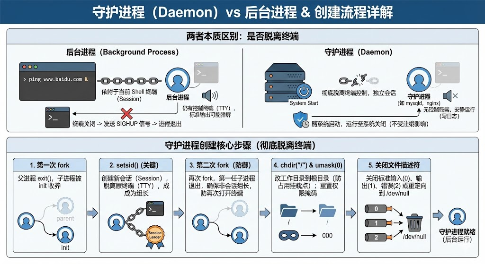

守护进程（Daemon），说白了就是**操作系统的“幕后英雄”**。

它不跟任何终端（屏幕、键盘）打交道，通常在系统启动时就开始跑，一直跑到系统关闭为止。像我们熟悉的 `mysqld`、`nginx`、`sshd` 都是守护进程。

关于它的创建流程和后台进程的区别，核心就在于“彻底脱离终端控制”。

具体逻辑如下：

### 一、 守护进程是如何创建的？

创建一个守护进程，其实就是把一个普通进程一步步“推向后台”，切断它和前台的所有联系。标准的编程步骤通常包含以下几步：

1. **第一次 fork：逃离父进程**
- 父进程 `fork()` 出子进程，然后父进程立即 `exit()`。
- **目的：** 让子进程成为“孤儿”，被 init 进程收养。同时，让 shell 以为这条命令执行完了，让出终端控制权。
1. **setsid()：自立门户**
- 子进程调用 `setsid()` 创建一个新的会话（Session）。
- **目的：** 彻底切断与原控制终端（TTY）的联系，并成为新会话的组长。
1. **第二次 fork：防止“旧情复燃”**
- 再 `fork()` 一次，然后第一任子进程退出，第二任子进程继续跑。
- **目的：** 确保新的进程**不是**会话组长。因为按照 System V 的规则，只有会话组长才能申请打开新的终端。为了防止它将来手贱不小心又连上某个终端，干脆剥夺它当组长的资格。
1. **chdir("/")：不留牵挂**
- 把当前工作目录改成根目录 `/`。
- **目的：** 假如你在 `/mnt/usb` 下启动了守护进程，它如果不换目录，这个 USB 盘就永远卸载（umount）不掉。
1. **umask(0)：重置权限**
- 将文件权限掩码设为 0。
- **目的：** 避免继承父进程的 umask 设置，确保守护进程在创建文件时拥有完全的权限控制。
1. **关闭文件描述符：耳不听心不烦**
- 关闭标准输入（0）、标准输出（1）、标准错误（2）。或者把它们重定向到 `/dev/null`。
- **目的：** 既然都没终端了，往屏幕上打印东西也没人看，甚至可能导致错误，干脆关掉。

---

### 二、 守护进程 vs 后台进程

虽然用 `&` 符号跑起来的程序（如 `ping ``www.baidu.com`` &`）也在后台，但它和守护进程有本质区别：

1. **生存期不同（这是最大的区别）**
    1. **后台进程：** 依然依附于当前的 Shell 终端。如果你把终端窗口关了（Session 断开），Shell 会给所有后台进程发一个 `SIGHUP` 信号，它们通常会**随之被杀死**。
    2. **守护进程：** 它是独立的会话。不管你怎么关终端、注销用户，它都**不受影响**，直到系统关机。
2. **控制终端（TTY）不同**
    1. **后台进程：** 还有控制终端。它的标准输出（stdout）依然默认连着你的屏幕，所以你经常会看到后台程序的日志突然弹到你的屏幕上。
    2. **守护进程：****没有**控制终端。它非常安静，有问题也是写日志文件，绝不会往屏幕上吐字。

---

### 三、 面试标准回答

守护进程和后台进程虽然都在后台运行，但它们在**独立性**和**生命周期**上有本质区别。

**首先，关于守护进程的创建，核心步骤是解除与控制终端的关联**：

1. **Fork 并退出父进程**：让子进程在后台运行，并由 init 进程接管。
2. **调用** `**setsid()**`**（核心步骤）**：创建一个新的会话，**彻底脱离原控制终端**、进程组和会话的控制。
3. **二次 Fork（防御性编程）**：防止进程再次获取控制终端。
4. **环境清理**：包括重设文件权限掩码（umask）、更改工作目录到根目录、关闭或重定向标准 IO 文件描述符（0, 1, 2）。

**其次，它与后台进程（Background Process）的区别在于**：

- **后台进程**（通过 `&` 启动）依然**继承**了当前终端的会话。如果终端关闭，后台进程会收到 `SIGHUP` 信号而退出。
- **守护进程**则完全**脱离**了终端会话。它不受用户登录注销的影响，通常随系统启动而运行，随系统关闭而终止。
