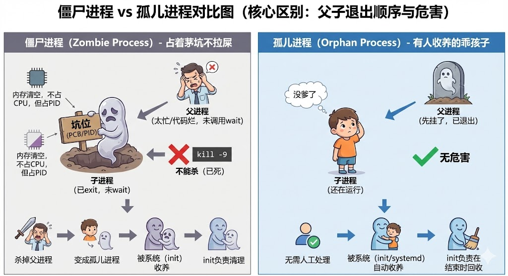

简单总结一下：**僵尸进程是“子死父不知”，占着坑位不走；孤儿进程是“父死子还在”，被系统收养了。**

具体区别和处理方式如下：

### 僵尸进程—— 占着茅坑不拉屎

- **什么是僵尸？**
    - 子进程已经运行完了（调用了 `exit`），本来该销毁了。但它的父进程太忙了（或者代码写得烂），没有调用 `wait()` 或 `waitpid()` 来收尸（获取子进程的退出状态）。
    - 此时，子进程虽然内存清空了，但它在系统的进程表里还**保留了一个位置（PCB）**，这就叫僵尸进程。
- **有什么危害？**
    - 僵尸进程不占内存，也不占 CPU。
    - **但是它占 PID（进程号）**。系统的 PID 数量是有限的（默认 32768）。如果僵尸太多，PID 被耗尽了，系统就无法创建新进程了。
- **怎么处理？**
    - **能不能杀？** 不能。它已经是死人了，你用 `kill -9` 是杀不死僵尸的。
    - **正确做法：** 杀掉它的**父进程**。父进程一死，僵尸进程就会变成“孤儿进程”，然后被系统（init 进程）收养，init 进程会负责把它们清理掉。

### 孤儿进程—— 有人收养的乖孩子

- **什么是孤儿？**
    - 父进程先挂了（退出了），但子进程还在运行。这时候子进程就没了爹，成了孤儿。
- **有什么危害？**
    - **完全没危害**。
    - Linux 系统非常仁慈，一旦发现有孤儿，**1 号进程（init/systemd）** 就会立马自动收养它，成为它的新父亲，并负责在它结束时帮他回收。
- **怎么处理？**
    - 不需要人工处理，系统机制会自动兜底。

---

### 面试标准回答

僵尸进程和孤儿进程都是由于父子进程退出时机不一致导致的，但它们的性质完全不同：

**第一，僵尸进程（Zombie Process）**：

- **定义**：子进程先结束，但父进程没有调用 `wait()` 来回收其状态信息。此时子进程的进程控制块（PCB）依然保留在内核中，处于 `Z` 状态。
- **危害**：虽然不消耗内存，但会占用 **PID 资源**。如果有大量僵尸进程，会导致 PID 耗尽，系统无法创建新进程。
- **处理**：**僵尸进程无法直接被 kill 杀死**（因为它已经死了）。解决办法是杀掉它的父进程，让它变成孤儿进程，由 init 进程接管并回收。

**第二，孤儿进程（Orphan Process）**：

- **定义**：父进程先结束，子进程还在运行。
- **危害**：**无危害**。
- **处理**：孤儿进程会被系统的 **init 进程（PID 1）** 自动收养。init 进程会负责等待它们结束并清理资源，所以孤儿进程能正常释放，不会造成资源泄漏。
