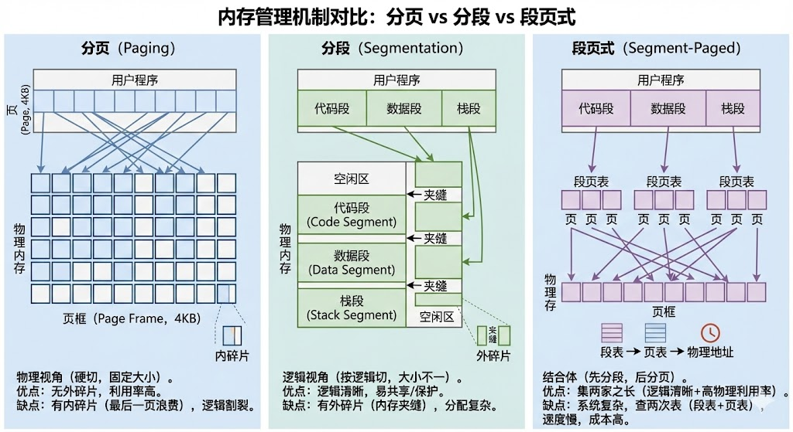

这三种机制，说白了就是操作系统怎么切蛋糕（内存）的问题。

它们的区别核心在于：**分页是为了让操作系统管起来方便（物理视角），分段是为了让程序员用起来舒服（逻辑视角），而段页式则是两者的结合。**

具体对比逻辑如下：

1. **分页**
- **做法：** 不管程序内容是啥，把内存硬切成大小固定的内存页（比如 4KB 一页）。
- **目的：** 为了**物理内存的管理效率**。
- **优点：**
    - **没有外碎片**：所有块都一样大，哪里有空位直接塞进去就行，内存利用率极高。
- **缺点：**
    - **有内碎片**：如果一个程序只有 4KB + 1 个字节，它也得占两个页（8KB），这多出来的空间就浪费了。
    - **逻辑割裂**：代码和数据可能被切碎了混在一起，不容易做共享和保护。
1. **分段**
- **做法：** 按照程序的逻辑逻辑来切。比如代码段切一块，数据段切一块，栈切一块。每块大小不一样。
- **目的：** 为了**满足用户的逻辑需求**。
- **优点：**
    - **逻辑清晰**：方便做权限控制（比如代码段只读，数据段可写）和内存共享（两个进程共享同一个代码段）。
- **缺点：**
    - **有外碎片**：内存里会产生很多“夹缝”，这块空地太小塞不进新程序，导致浪费。
1. **段页式**
- **做法：** 先按逻辑分段（用户视角），然后把每个段再切成固定大小的页（系统视角）。
- **目的：** 集两家之长。
- **优缺点：** 既有了分段的逻辑优势，又有了分页的物理利用率。但缺点是**硬件造价高，系统复杂**，因为地址变换要查两次表（段表+页表），速度会慢一点。

---

### 面试标准回答

分段、分页和段页式是三种不同的内存管理机制，它们的区别主要体现在**分割方式**、**碎片类型**和**目的**上：

**第一，分页（Paging）**：

- **原理**：将内存空间切分为**固定大小**的页（如 4KB）。它是信息的**物理单位**。
- **优缺点**：主要解决了**外部碎片**问题，内存利用率高。但会产生**内部碎片**（最后一页没装满），且页面内容缺乏逻辑含义，不利于共享和保护。
- **目的**：主要是为了配合硬件，提高操作系统的内存管理效率。

**第二，分段（Segmentation）**：

- **原理**：按照程序的**逻辑结构**（如代码段、数据段、栈）划分内存，段长不固定。它是信息的**逻辑单位**。
- **优缺点**：没有内部碎片，方便实现**信息共享和保护**（程序员更喜欢）。但会产生严重的**外部碎片**，内存分配算法也更复杂。
- **目的**：主要是为了满足用户（程序员）的编程和逻辑需求。

**第三，段页式（Segment-Paged）**：

- **原理**：结合了两者。**先将用户程序分段，再将每个段分页**。
- **总结**：它既保留了分段便于共享保护的优点，又保留了分页解决外部碎片的优点。
- **代价**：增加了硬件成本和系统复杂度，地址变换需要**查两次表**（先查段表，再查页表），可能会对性能有轻微影响。
