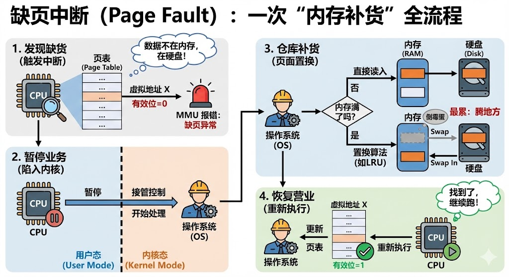

缺页中断（Page Fault），说白了就是“CPU 想找个数据，结果发现这数据不在内存里，得赶紧去硬盘拉回来”的信号。

它是操作系统实现“虚拟内存”和“按需加载”的关键机制。没有它，我们的电脑就没法用 8G 的内存跑 50G 的游戏。

整个过程其实就是一次“补货”的流程：

1. **发现缺货（触发中断）**

CPU 执行指令时，拿着虚拟地址去查页表。

- 结果发现页表项里的“有效位”（Present Bit）是 0。
- 这意味着：这块数据虽然在逻辑上存在，但物理上还没加载到内存条里（可能还在硬盘的 Swap 分区或者文件里）。
- 此时，MMU（内存管理单元）会立马报错，触发“缺页异常”。
1. **暂停业务（陷入内核）**
- CPU 暂停当前正在执行的指令，从用户态切换到内核态。
- 操作系统接管控制权，开始处理这个“烂摊子”。
1. **仓库补货（页面置换）**
- 操作系统去硬盘里找到这页数据。
- **情况 A（内存有空位）：** 直接把数据读进内存。
- **情况 B（内存满了）：** 这就是最累的时候。操作系统必须根据算法（比如 LRU）挑一个“倒霉蛋”（很久没用的页面）踢出去（写回硬盘），腾出地方把新数据放进来。
1. **恢复营业（重新执行）**
- 数据放好后，操作系统修改页表，把“有效位”改成 1。
- 然后退出内核态，让 CPU **重新执行**刚才那条失败的指令。这次就能找到了。

---

### 面试标准回答

缺页中断（Page Fault）是内存管理中的一种特殊**异常**，它发生在应用程序访问一个‘已映射但未加载到物理内存’的页面时。

它的核心处理流程可以分为四步：

第一，硬件检测与陷入：

当 MMU（内存管理单元）在进行地址转换时，发现页表项的 Present Bit（存在位） 为 0，就会触发缺页异常。CPU 会暂停当前指令，陷入内核态，调用缺页中断处理程序。

第二，寻找空闲物理页：

操作系统需要为即将调入的页面分配物理内存。

- 如果内存未满，直接分配一个空闲页框。
- 如果内存已满，则需要通过**页面置换算法**（如 LRU、Clock）选择一个牺牲页，将其换出到磁盘（Swap），从而腾出空间。

第三，磁盘 I/O（最耗时的一步）：

操作系统发起 I/O 请求，将缺失的页面从磁盘加载到物理内存中。

第四，更新页表与重试：

数据加载完成后，操作系统更新页表（将存在位置为 1，填入物理地址），然后退出中断，重新执行导致异常的那条指令。
