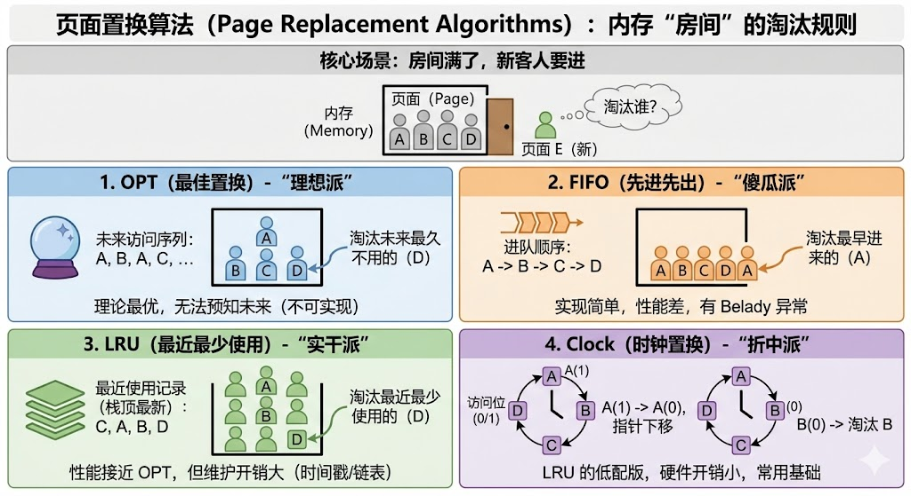

页面置换算法，说白了就是“内存满了，新客人要进屋，该把哪个旧客人踢出去”的淘汰规则。

操作系统要在“踢得准”（保证留下的都是常引用的）和“踢得快”（算法开销小）之间做权衡。

最经典的算法主要有这 4 种，我们可以把它们分为“理想派”、“傻瓜派”、“实干派”和“折中派”：

1. **OPT（最佳置换算法）**
- **规则：** 选择在**未来**最长时间内不再被访问的页面踢出去。
- **特点：** 它是理论上缺页率最低的算法。但它要求操作系统能**预知未来**（知道程序下一步要访问啥），这根本不可能实现。
- **作用：** 虽然用不了，但它是一个**标尺**。我们评价其他算法好不好，就看它离 OPT 有多近。
1. **FIFO（先进先出算法）**
- **规则：** 谁先来的，谁先滚。维护一个队列，先进先出。
- **特点：** 实现最简单。但效果很差。因为它可能会把那些**初始化完还在频繁使用**的核心库给踢出去，仅仅因为它们进来的早。
- **Bug：** 它有个著名的**Belady 异常**（给的内存多了，缺页次数反而变多了），面试必考点。
1. **LRU（最近最少使用算法）**
- **规则：** 谁最近没被用过，谁就滚。它认为“如果刚才被访问了，那接下来大概率还会被访问”。
- **特点：** 性能非常好，最接近 OPT。
- **代价：** 实现起来**成本很高**。因为每次访问内存，都得去更新一下这个页面的“时间戳”或者移动链表节点，这对硬件和 CPU 都是不小的负担。
1. **Clock（时钟置换算法 / NRU）**
- **规则：** 把所有页面排成一个圆圈（像时钟一样），指针转圈扫描。
- **机制：** 给每个页加个“访问位”（0 或 1）。
    - 指针指到谁，如果是 1，说明最近用过，给它一次机会（置为 0），指针往下走。
    - 如果是 0，说明最近没用过，直接踢掉。
- **特点：** 它是 LRU 的低配版，不需要精确记录时间，只记录“有没有用过”。效率高，硬件开销小，是**现代操作系统最常用**的策略基础。

### 面试标准回答

常见的页面置换算法主要有四种，它们的演进逻辑是围绕着‘性能’和‘开销’的平衡展开的：

第一，最佳置换算法（OPT）：

淘汰未来最长时间不使用的页面。这只是一个理论上的最优值，用来作为评价其他算法的标准，实际上因为无法预知未来而无法实现。

第二，先进先出算法（FIFO）：

淘汰最早进入内存的页面。优点是实现简单，但缺点是性能差，可能会淘汰频繁使用的页面（如常用库），并且存在 Belady 异常（物理页增加，缺页率反而上升）的现象。

第三，最近最少使用算法（LRU）：

淘汰最近一段时间最久未被使用的页面。这是最常用的思想，因为利用了程序的局部性原理，性能很好。但其硬件实现成本较高（需要频繁维护链表或时间戳）。

第四，时钟置换算法（Clock）：

这是 LRU 的一种工程近似实现。它通过循环链表和‘访问位’来模拟 LRU。

- 如果页面被访问，访问位置 1。
- 淘汰时，检查访问位：如果是 1，给一次机会置 0 并跳过；如果是 0，则淘汰。
- 它在保证了性能接近 LRU 的同时，极大地降低了系统开销，是目前操作系统中应用最广泛算法的基础。
