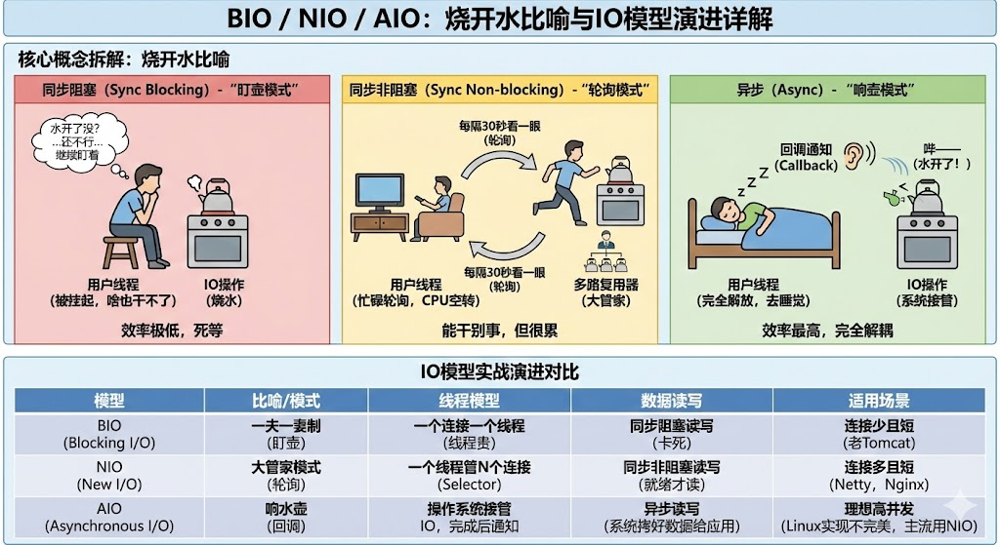

这组概念是很多同学的非常不理解的，因为它们太像了，容易绕晕。

要彻底搞懂，我们得把“关注点”拆开来看：

- **阻塞/非阻塞**：关注的是**当前线程的状态**（是死等，还是能干别的）。
- **同步/异步**：关注的是**消息通知的机制**（是我自己去轮询结果，还是你回调通知我）。
- **BIO/NIO/AIO**：是基于上面这两种维度组合出来的**具体 IO 模型**。

下面我们用一个“烧开水”的例子把它们一次性讲透：

### 核心概念拆解

**场景：你想喝水，于是去把水壶放到火上烧。**

- **同步阻塞（Sync Blocking）：**
    - 你站在灶台边上，死死盯着水壶，直到水开。
    - **特点：** 啥也干不了，CPU（你）被挂起，效率极低。
- **同步非阻塞（Sync Non-blocking）：**
    - 你把水壶放上去，然后去客厅看电视。但你心里不踏实，每隔 30 秒就跑回厨房看一眼“水开了没”。
    - **特点：** 线程没被挂起，能干别的事，但因为要不断**轮询（Polling）**，CPU 会空转，也很累。
- **异步（Async）：**
    - 你买了个**响水壶**（或者找了个保姆）。你把水壶放上去就可以完全把这事忘了，去睡觉都行。等水开了，水壶会“哔——”一声叫你（回调通知）。
    - **特点：** 效率最高，完全解耦。

---

### BIO、NIO、AIO 的实战演进

**BIO (Blocking I/O) —— 传统的“一夫一妻制”**

- **模型：****同步阻塞**。
- **流程：** 也就是上面的“盯着烧水”。服务器端有一个客户端连进来，就得分配一个线程专门伺候它。如果客户端连上了但不发数据，这个线程就卡在那里死等。
- **缺点：** 线程是很贵的资源。如果有 10 万个连接，你开不起 10 万个线程。
- **适用：** 连接少且短的场景（比如以前的 Tomcat 默认模式）。

**NIO (New I/O / Non-blocking I/O) —— 进化的“大管家模式”**

- **模型：****同步非阻塞**（底层是 **IO 多路复用**，如 Linux 的 epoll）。
- **流程：** 也就是“轮询烧水”，但经过了优化。
    - 这就好比弄了个“大管家”（Selector）。10 万个客户端连接（Channel）全交给大管家一个人管。
    - 大管家不断地看（select）：谁的数据到了？谁想写数据了？
    - 只有当某个连接真的有动静了，大管家才通知工作线程去处理。
- **本质：** 一个线程管理 N 个连接。
- **适用：** 连接多且连接时间短（轻操作）的场景（如 Netty、Nginx、RPC 框架）。

**AIO (Asynchronous I/O)**

- **模型：****异步非阻塞**。
- **流程：** 也就是“响水壶”。
    - 应用程序告诉操作系统：“我要读这个文件，你读完了把数据放到我的缓冲区里，然后叫我一声（执行回调）”。
    - 在操作系统读数据的过程中，应用程序完全不用管。
- **现状：** 理想很丰满，但 Linux 下的 AIO 实现并不完美（主要是模拟出来的），所以目前主流的高性能框架（如 Netty）反而是用 NIO 更多。

---

### 面试标准回答

这三个概念代表了 IO 模型演进的三个阶段，核心区别在于**对线程的利用率**和**数据的读写方式**。

第一，BIO（Blocking IO）是同步阻塞模型。

它是最传统的方式。服务端采用‘一个连接一个线程’的模型。当线程在进行 IO 读写时，如果数据没准备好，线程会被挂起（阻塞），无法处理其他任务。这就导致它在面对高并发时，因为线程开销过大而性能低下。

第二，NIO（Non-blocking IO）是同步非阻塞模型。

它是目前主流框架（如 Netty、Tomcat）的基石。它的核心是引入了 Selector（多路复用器）。

- 通过 Selector，**一个线程就可以管理成千上万个连接（Channel）**。
- 线程不再傻等，而是通过 Selector 轮询查看哪些连接‘有数据可读’或‘可写’，只处理那些活跃的连接。
- 这极大提升了并发能力，解决了线程资源浪费的问题。

第三，AIO（Asynchronous IO）是异步非阻塞模型。

它基于操作系统的异步通知机制。

- **NIO 与 AIO 的最大区别在于**：NIO 是数据准备好了，通知应用程序，应用程序**自己去把数据从内核拷贝到用户空间**（这个过程是同步的）；而 AIO 是操作系统帮你把数据拷贝好了，直接通知你拿去用（真正的异步）。
