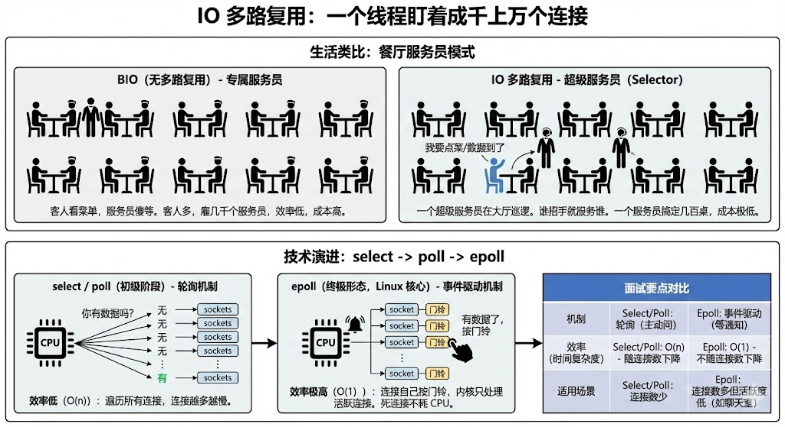

IO 多路复用，说白了就是“用一个线程，同时盯着成千上万个连接”的技术。

它的核心目的就是**解决高并发（C10K 问题）**。在它出现之前，服务器每收一个连接就得开一个线程，连接一多，CPU 光是用来切换线程（上下文切换）就累吐血了，根本没精力处理业务。

多路复用把这个模式改了：它不再让应用层傻等，而是把所有连接都丢给操作系统内核去“监管”，哪个连接有数据了，内核再通知应用层去处理。

具体可以按照“生活类比”**和**“技术演进”两个层面来理解：

1. **生活类比（服务员模式）**
- **BIO（没用多路复用）：** 就像一个餐厅，每来一个客人，就必须配一个专属服务员。客人看菜单看半小时，服务员就得傻站半小时。客人多了，餐厅得雇几千个服务员，老板直接破产。
- **IO 多路复用：** 就像一个餐厅只雇**一个**超级服务员（Selector）。
    - 所有客人都坐在大厅里。
    - 超级服务员在大厅巡逻（或者在前台等）。
    - 谁招手说“我要点菜”（数据到了），服务员就过去服务那一桌。
    - 没人招手时，服务员就在那歇着（阻塞），或者干别的。
    - **结果：** 一个服务员就能服务几百桌客人，成本极低。
1. 技术演进（select -> poll -> epoll）

虽然都是多路复用，但在这个超级服务员的工作方式上，经历了三个阶段的升级：

- **select / poll（初级阶段）：**
    - **机制：** 也就是“轮询”。应用层把 1000 个连接扔给内核。内核就像个负责任的巡逻员，一遍一遍地问这 1000 个连接：“你有数据吗？你有数据吗？”
    - **缺点：** 效率低。每次都要遍历所有连接（O(n)），而且连接数多了（比如几万个），每次遍历都慢得要死。
- **epoll（终极形态，Linux 核心）：**
    - **机制：** 也就是“事件驱动”。内核给每个连接挂了个“门铃”（回调函数）。
    - **流程：** 哪个连接有数据了，自己按门铃。内核听到门铃响，直接把那个按铃的连接拿出来给应用程序。
    - **优点：** 效率极高。不管你连了 1 万个还是 10 万个，内核只处理那些“活跃”的连接（O(1)），死连接根本不消耗 CPU。

---

### 面试标准回答

IO 多路复用是一种同步 IO 模型，它的核心思想是**用一个线程来监听多个文件描述符（Socket）**。

它的工作流程是：应用层将关注的一组 Socket 提交给操作系统内核（通过 select/poll/epoll 系统调用），然后线程阻塞。当这些 Socket 中有任何一个或多个变得‘可读’或‘可写’时，内核会唤醒该线程，线程再去处理那些活跃的连接。

**这种机制主要解决了传统多线程模型（BIO）中上下文切换开销过大的问题**，是 Redis、Nginx、Netty 等高性能框架的基石。

**在具体的实现方式上，Linux 主要经历了从 select 到 epoll 的演变：**

1. Select/Poll：
    1. 它们采用的是轮询机制。每次调用，内核都需要遍历整个 Socket 列表来检查状态。这导致其性能随着连接数的增加而线性下降（时间复杂度 O(n)），且 Select 还有最大连接数（1024）的限制。
2. Epoll（重点）：
3. 它是对 Select 的重大改进，基于事件驱动机制。
    1. 它在内核中维护了一个红黑树来管理所有连接，不需要每次重复传入。
    2. 当 Socket 有数据时，会触发**回调函数**，将其加入到一个‘就绪链表’中。
    3. 调用 epoll_wait 时，直接返回就绪链表里的连接。
    4. 这意味着 Epoll 的性能不会因为连接总数的增加而下降（时间复杂度 O(1)），特别适合连接数多但活跃度低的场景（如推送服务、聊天室）。
