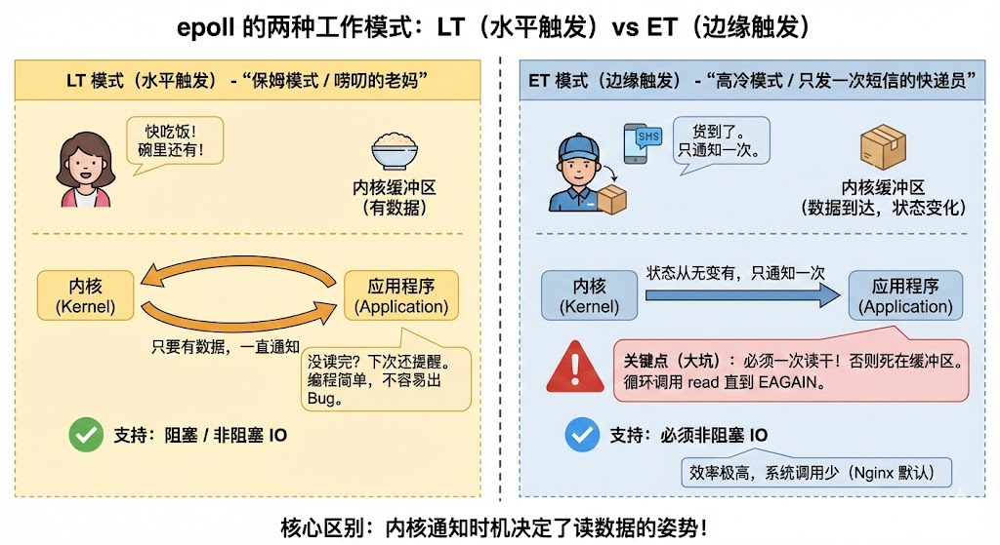

这就是“保姆模式”**（LT）和**“高冷模式”（ET）的区别。

简单来说：**LT 是只要有数据没读完，内核就会一直催你；ET 是数据来了只通知你一次，你不读完拉倒，下次不再提醒。**

这两者决定了你写代码时，读数据的姿势必须不一样。

具体逻辑拆解如下：

1. **LT 模式（Level Triggered，水平触发）**
- **就像是“唠叨的老妈”：** 只要碗里还有饭（内核缓冲区里还有数据），她就会一直喊你“快吃饭”。你吃了一口没吃完，放下筷子去玩了，过一会她还会喊你“快吃饭”。
- **技术表现：** 只要 Socket 处于“可读”状态，每次调用 `epoll_wait`，内核都会通知你。
- **优点：** 编程简单，不容易出 Bug。你不用担心一次读不完导致数据丢失，反正内核会兜底提醒。
- **支持：** 阻塞和非阻塞 IO 都行。
1. **ET 模式（Edge Triggered，边缘触发）**
- **就像是“只发一次短信的快递员”：** 快递到了，他发个短信“货到了”。如果你没去拿，或者只拿了一半留了一半在柜子里，他是绝对不会再发第二条短信的。除非又有新的快递送来。
- **技术表现：** 只有在数据状态**从“无”变“有”**（或者从不可读变可读）的那一瞬间，内核才会通知你一次。
- **关键点（大坑）：** 因为它只提醒一次，所以你收到通知后，必须**一次性把数据读干/写干**（循环调用 `read` 直到返回 -1 且 `errno` 为 `EAGAIN`）。否则剩下的数据就死在缓冲区里了，永远没人处理。
- **优点：** 效率极高。减少了 `epoll_wait` 被频繁唤醒的次数（系统调用次数少），Nginx 等高性能中间件默认用的就是这个。
- **支持：** 必须配合**非阻塞 IO** 使用。

---

### 面试标准回答

LT（水平触发）和 ET（边缘触发）是 epoll 的两种工作模式，核心区别在于**内核通知应用程序的时机**不同：

**第一，LT 模式（Level Triggered）**：

- 这是 epoll 的**默认模式**。
- **机制**：只要文件描述符（FD）还有数据可读，每次调用 `epoll_wait` 都会返回该 FD，提醒应用程序处理。
- **特点**：编程模型简单，不易漏读数据，支持阻塞和非阻塞 IO。

**第二，ET 模式（Edge Triggered）**：

- 这是**高性能模式**（如 Nginx 使用）。
- **机制**：它只在 FD 的状态**发生变化**时（例如从不可读变为可读）通知应用程序**一次**。如果应用程序没有一次性读完缓冲区的数据，内核不会再次通知，直到下一次新数据到达。
- **特点**：这就要求我们在收到通知后，必须使用**非阻塞 IO** 并在一个循环里**一次性把数据读完**（直到 `read` 返回 `EAGAIN` 错误）。
