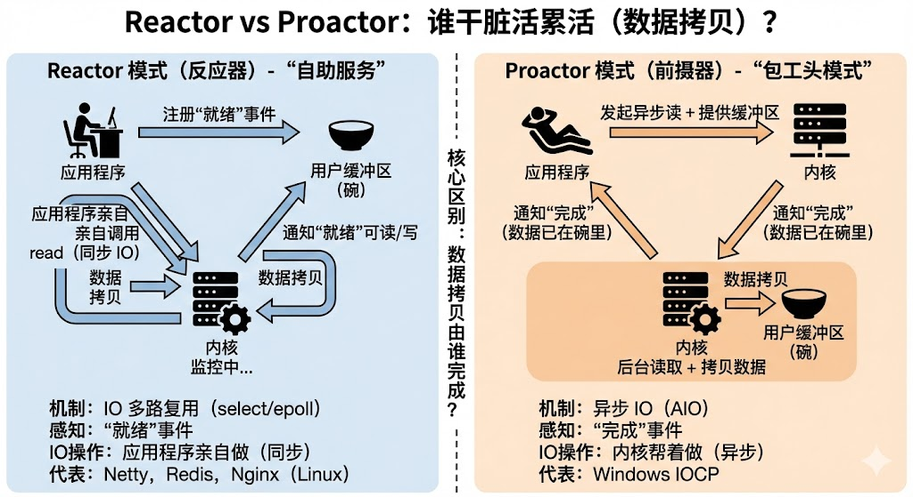

简单一句话总结：**Reactor 是“来了事件你自己去处理”，Proactor 是“我帮你处理好了再通知你”。**

本质的区别在于：**到底是谁把数据从内核空间拷贝到用户空间（谁负责干脏活累活）？**

具体可以从这两个形象的场景来理解：

1. **Reactor 模式（反应器）**
- **机制：** 基于 **IO 多路复用**（select/epoll）。
- **流程：**
    - 你（应用程序）告诉内核：“有新连接或者有数据来了，告诉我一声”。
    - 内核一直在那盯着。一旦有数据来了，内核喊你：“喂，数据到了，**你自己来拿**”。
    - 你（应用程序）必须放下手里的活，**亲自调用 read**，把数据从内核读到自己的内存里，然后再处理业务。
- **特点：** 感知的是“就绪可读/可写”**事件。读写数据的过程是**同步的（你自己读）。
- **代表：** Netty、Redis、Nginx。
1. **Proactor 模式（前摄器）—— “包工头模式”**
- **机制：** 基于真正的 **异步 IO**（AIO）。
- **流程：**
    - 你（应用程序）给内核一个空的缓冲区，并交代：“帮我把数据读到这个碗里，读完了再叫我”。然后你就去玩了（完全不阻塞）。
    - 内核在后台默默地把数据从网卡读出来，**顺手帮你拷贝到**你给的那个碗里。
    - 全部搞定后，内核通知你：“喂，活干完了，数据已经在碗里了，你直接用吧”。
- **特点：** 感知的是“完成”**事件。读写数据的过程是**异步的（内核帮你读）。
- **代表：** Windows 的 IOCP（最典型的 Proactor）。
1. **为什么 Linux 下主流是 Reactor？**
- 虽然 Proactor 听起来更爽（真正的甩手掌柜），但 Linux 下的异步 IO（AIO）实现一直不够成熟，性能提升不明显。
- 相反，Linux 的 **epoll**（Reactor 的基石）极其强大。所以像 Netty 这种高性能框架，在 Linux 上底层用的还是 Reactor，只是在应用层封装得像 Proactor 一样。

---

### 面试标准回答

Reactor 和 Proactor 的根本区别在于**IO 操作由谁完成**，以及**通知的时机**不同。

**第一，Reactor 模式（基于同步 IO）**：

- **核心思想**：它关注的是**IO 就绪事件**。
- **工作流程**：应用程序向内核注册感兴趣的事件（如可读、可写）。当事件发生时，内核通知应用程序。**应用程序必须亲自调用 read/write 方法**，将数据从内核拷贝到用户空间，这一步是同步的。
- **应用**：Linux 下的 epoll 就是典型的 Reactor 实现，Redis、Netty 默认也都是这种模型。

**第二，Proactor 模式（基于异步 IO）**：

- **核心思想**：它关注的是**IO 完成事件**。
- **工作流程**：应用程序直接发起异步读写请求，并传入缓冲区。内核负责在后台完成所有的数据拷贝工作。当数据已经**完全准备好**在用户缓冲区时，内核才通知应用程序直接使用。
- **应用**：Windows 的 IOCP 是真正的 Proactor 实现。
