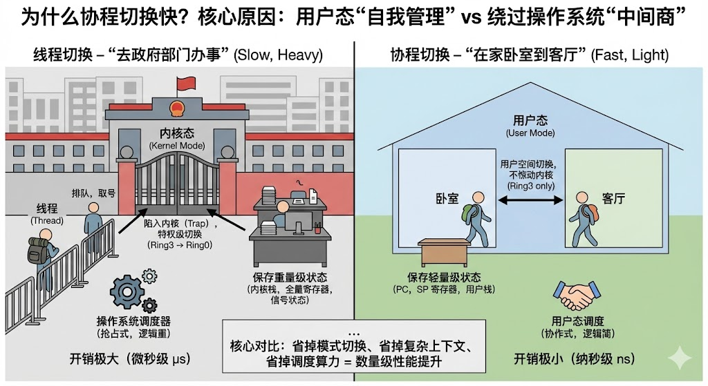

协程切换之所以快，核心就一句话：**因为它完全是用户态的“自我管理”，彻底绕过了操作系统这个“中间商”**。

我们可以把线程切换比作去政府部门办事（进内核），你得取号、排队、填一大堆表（保存内核栈）、接受安检（权限校验），流程非常繁琐。

而协程切换就像是你在自己家从卧室走到客厅（用户态），想走就走，没人管你，换个拖鞋（保存寄存器）就行了。

具体快在哪里，可以从这三个“省掉的开销”来理解：

1. **省掉了“模式切换”的开销**
- **线程：** 线程是归操作系统管的。要切换线程，CPU 必须从**用户态（Ring 3）** 切换到 **内核态（Ring 0）**。这个过程涉及 CPU 特权级的变更、中断处理，开销很大。
- **协程：** 协程本质上只是应用程序里的一个函数调用。切换时，CPU 一直待在**用户态**，根本不需要惊动操作系统内核。
1. **省掉了“复杂的上下文保存”**
- **线程：** 切换时，操作系统要保存非常多的东西：所有的寄存器、内核栈状态、信号掩码、页表指针（如果是跨进程）等，数据量大。
- **协程：** 只需要保存最基本的**CPU 寄存器**（比如程序计数器 PC 和栈指针 SP）和**用户栈**。数据量极小，就像保存一个游戏存档一样简单。
1. **省掉了“调度算法”的算力**
- **线程：** 操作系统的调度器非常复杂（CFS 算法），它要计算优先级、判断时间片、处理抢占，逻辑很重。
- **协程：** 调度逻辑由用户代码（或运行时环境，如 Go Scheduler）控制，通常是协作式的（Cooperative），逻辑非常简单，没有复杂的抢占计算。

---

### 面试标准回答（建议背诵）

协程切换相比线程切换，性能上有数量级的提升（通常是纳秒级 vs 微秒级），主要原因有三点：

第一，避免了用户态与内核态的切换（最核心原因）：

线程是内核调度的，切换时必须陷入内核态（Trap），涉及昂贵的系统调用和特权级切换。

而协程是用户态的轻量级线程，其切换完全在用户空间进行，不需要操作系统介入。

**第二，上下文保存的内容更少**：

- **线程切换**需要保存重量级的内核状态（包括内核栈、全量寄存器、信号状态等）。
- **协程切换**只需要保存极少量的**用户态寄存器**（主要是程序计数器 PC 和栈指针 SP）以及用户栈，开销极低。

第三，调度策略更简单高效：

线程调度依赖操作系统的抢占式调度算法，逻辑复杂且可能引发 Cache 失效。

而协程通常采用协作式调度（或用户态调度器），可以根据业务逻辑灵活控制让出时机，且更有利于保持 CPU 缓存的热度（Locality）。
