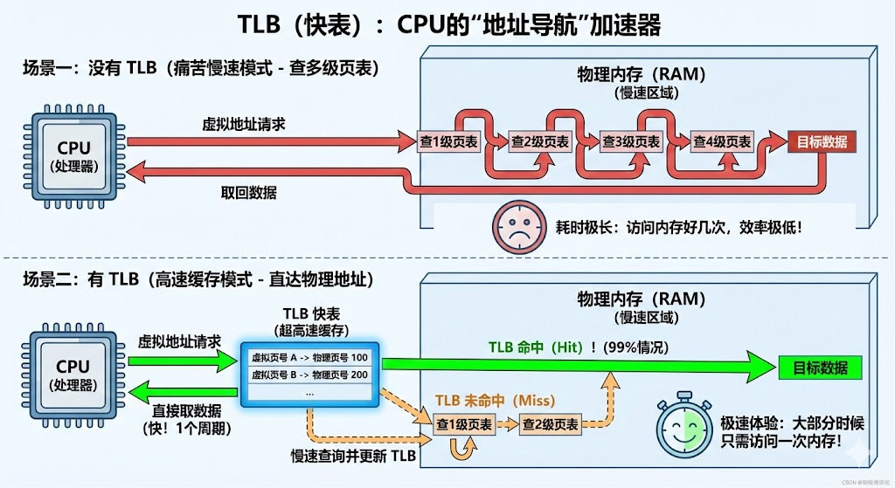

简单来说，TLB就是**CPU 里专门用来存“页表项”的一个超高速缓存**。

它的核心作用只有一个：**免去查内存页表的苦，直接告诉你物理地址在哪。**

在没有 TLB 的情况下，CPU 每访问一次数据，可能需要访问内存好几次（查多级页表 + 取数据）；有了 TLB，大部分时候只需要访问一次内存（直接取数据）。

具体的工作原理和加速逻辑如下：

1. **为什么要用它？**
- **痛点：** 现代操作系统都用**多级页表**。比如在 64 位系统下，要把一个虚拟地址转换成物理地址，CPU 可能需要先去内存里查 4 次页表（4 级目录）。
- **后果：** 内存的速度比 CPU 慢几百倍。为了取一个数据，先要在内存里跑 4 趟腿查地址，这效率低得无法接受。
1. **它怎么干活？**
- **机制：** TLB 利用了程序的**局部性原理**。既然你刚才访问了这个页面，那你接下来大概率还会访问这个页面里的数据。
- **流程：**
    - CPU 发出一个虚拟地址。
    - **先查 TLB：** 硬件直接在 TLB 这个小本本里找：“哎，这个虚拟页号刚才查过吗？”
    - **TLB 命中（Hit）：** 找到了！直接拿到物理地址，不用去内存查页表了。**速度：1 个 CPU 周期。**
    - **TLB 未命中（Miss）：** 没找到。没办法，老老实实去内存里走一遍 4 级页表的查询流程（Page Walk），找到物理地址后，**顺手把这个映射关系填进 TLB**，下次就能用了。
1. **效果如何？**
- 因为程序的局部性很好，TLB 的命中率通常高达 99% 以上。这意味着绝大多数时候，CPU 访问内存都像没有虚拟内存一样快。

### 面试标准回答

TLB，也就是我们常说的**快表**，它是位于 CPU **MMU（内存管理单元）** 内部的一种专用硬件缓存。

**它的核心作用是加速虚拟地址到物理地址的转换过程。**

**具体的加速原理如下**：

1. 缓存页表项：
2. 在虚拟内存系统中，CPU 访问内存需要查页表。由于页表存放在内存中（尤其是多级页表），一次数据访问可能引发多次内存访问，严重拖慢 CPU 速度。TLB 用来缓存近期使用过的**‘虚拟页号 -> 物理页号’**的映射关系。
3. 减少内存访问：
4. 当 CPU 访问地址时，硬件会优先查询 TLB。
    1. 如果**命中（TLB Hit）**，CPU 可以直接获得物理地址，**完全跳过**在内存中查询页表的步骤。
    2. 只有在未命中（TLB Miss）时，CPU 才需要去访问内存中的页表，并将结果更新到 TLB 中。
