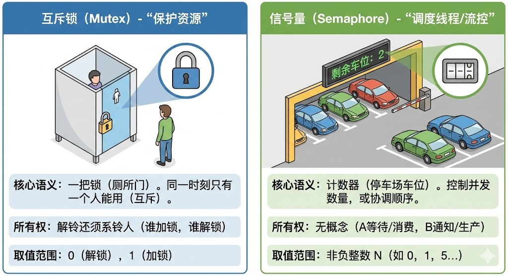

互斥锁（Mutex）和信号量（Semaphore）虽然都能解决并发问题，但它们的**设计初衷**和**使用场景**是完全不同的。

用一句大白话总结：**互斥锁****是为了“保护资源”，保证同一时刻只有一个人能用；****信号量****是为了“调度线程”，控制有多少人能用，或者谁先谁后。**

具体区别可以从以下三个维度来拆解：

1. **核心语义不同（锁 vs 计数器）**
- **互斥锁****（****Mutex****）：** 它是一个“锁”**。就像厕所的门，进去一个人锁上，其他人就进不去了。它的目标是**互斥，确保临界区代码同一时间只有一个线程在跑。
- **信号量****（****Semaphore****）：** 它是一个“计数器”**（或者是红绿灯）。就像停车场的剩余车位牌。如果初始值是 5，就允许 5 个人同时进去。它的目标是**资源流控**或者**线程同步。
1. **所有权（Ownership）不同 —— 这是最本质的区别**
- **互斥锁****：** 讲究“解铃还须系铃人”。线程 A 拿了锁，必须由线程 A 来释放锁。如果 A 死了或者没释放，锁就永远死锁了。
- **信号量****：****没有所有权**的概念。线程 A 可以执行 `wait`（P操作，消费资源），而由线程 B 执行 `signal`（V操作，生产资源）。这使得信号量非常适合用于“生产者-消费者”模式，用来通知“活干完了”。
1. **取值范围不同**
- **互斥锁：** 只有 **0**（解锁）和 **1**（加锁）两个状态。
- **信号量：** 是一个非负整数。
    - 如果是 **1**（二元信号量），功能上近似于互斥锁。
    - 如果是 **N**（计数信号量），就是用来控制并发数量的（比如限流）。

### 面试标准回答

互斥锁和信号量都是操作系统中用于并发控制的机制，但它们的设计目的和特性有本质区别：

**第一，设计意图不同**：

- **互斥锁（Mutex）用于互斥（Mutual Exclusion）**，是为了保护临界资源，保证同一时刻只有一个线程访问。
- **信号量（Semaphore）用于同步（Synchronization）或资源管控**，用于协调多个线程的执行顺序，或者控制系统中可用资源的并发数量（如数据库连接池）。

**第二，所有权（Ownership）不同（最关键点）**：

- **互斥锁具有严格的所有权**：谁加锁，必须由谁解锁。如果持有锁的线程意外退出，可能导致死锁（这就需要锁的健壮性机制）。
- **信号量没有所有权**：它可以由一个线程进行 P 操作（减少），由另一个线程进行 V 操作（增加）。这使得它非常适合解决‘生产者-消费者’问题。

**第三，状态数量不同**：

- 互斥锁只有加锁和解锁两种状态。
- 信号量内部维护一个计数器，可以允许多个线程同时进入（取决于初始计数值）。

**总结**：如果要做临界区的排他性访问，用 Mutex；如果要控制并发流或者线程间的协作通知，用 Semaphore。
