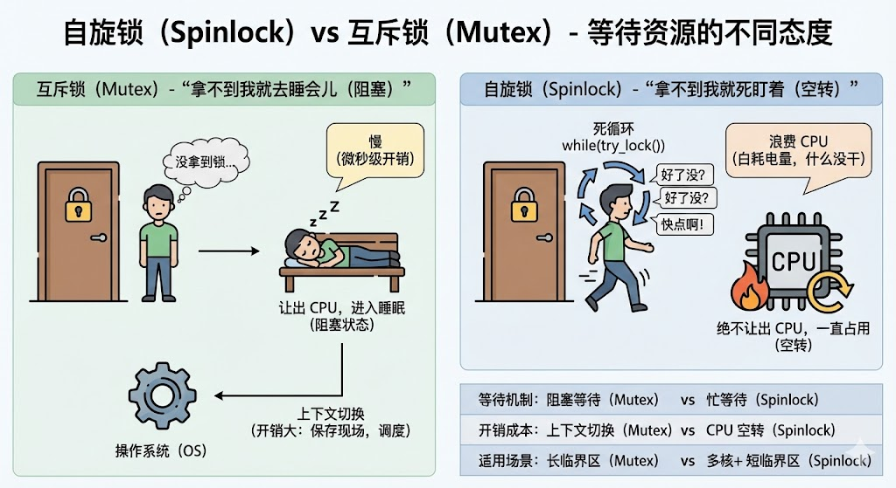

自旋锁和互斥锁，说白了就是**当资源被占用时，等待者的两种不同态度**。

简单总结：**互斥锁是“拿不到我就去睡会儿（阻塞）”，自旋锁是“拿不到我就死盯着（空转）”。**

它们的区别和适用场景主要体现在以下几个维度的权衡上：

1. **等待机制不同（最本质的区别）**
- **互斥锁（Mutex）：** 只要拿不到锁，线程就会**立即让出 CPU**，进入睡眠（阻塞）状态。操作系统会发生**上下文切换**，把它挂起，等锁释放了再把它唤醒。
- **自旋锁（Spinlock）：** 拿不到锁，线程**绝不让出 CPU**。它会在 CPU 上跑一个死循环（`while(try_lock())`），一直不停地问：“好了没？好了没？”，直到拿到锁为止。
1. **开销成本不同**
- **互斥锁的成本：** 主要在于**上下文切换**。线程从运行切到阻塞，再切回来，需要保存寄存器、查调度表，这动作很慢（微秒级）。如果你的代码只跑了几纳秒，却花了 2 微秒去切换线程，这就亏大了。
- **自旋锁的成本：** 主要在于**浪费 CPU**。如果锁被别人占了很久，你的线程就在那空转，白白消耗电量和算力，什么活也没干。
1. 适用场景（什么时候用自旋锁？）

必须同时满足以下两个条件，才是自旋锁的用武之地：

- **条件一：临界区非常短。** 也就是拿到锁之后干的活非常快（比如只是修改一个整数）。快到“等待的时间”比“线程切换的时间”还要短。
- **条件二：必须是多核 CPU。** 如果是单核，你占着 CPU 自旋，那个持有锁的线程就没机会运行来释放锁了，这会卡死。

---

### 面试标准回答

自旋锁和互斥锁是两种解决并发竞争的机制，它们的核心区别在于**等待锁时的行为**不同：

第一，互斥锁（Mutex）是‘阻塞等待’。

当线程获取不到锁时，会主动让出 CPU，进入阻塞状态，触发操作系统的上下文切换。

- **优点**：适合锁会被持有较长时间的场景，因为它不会白白浪费 CPU 资源。
- **缺点**：如果临界区执行极快，那么线程挂起和唤醒的开销（上下文切换）可能比执行代码本身的开销还大，导致性能下降。

第二，自旋锁（Spinlock）是‘忙等待’。

当获取不到锁时，线程不会让出 CPU，而是通过循环检测的方式一直占用 CPU 进行轮询。

- **优点**：避免了昂贵的上下文切换，对于**短时间**的等待，效率极高。
- **缺点**：如果持有锁的线程执行时间过长，自旋线程会长时间占用 CPU 空转，导致 CPU 资源浪费。

关于自旋锁的使用场景：

它主要用于多核环境下且临界区极短的场景。

比如 Linux 内核的中断处理程序中，或者在用户态实现高性能 CAS 操作时。如果临界区涉及到 IO 操作或者复杂逻辑，绝对不能用自旋锁。
