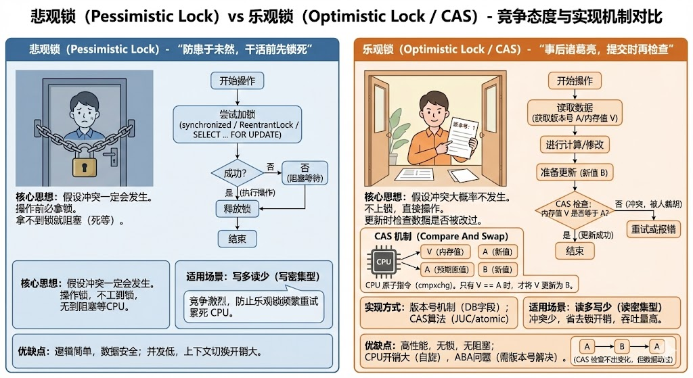

这两种锁的区别，本质上就是“看待竞争的态度”不同。

简单来说：**悲观锁****是“防患于未然”，觉得哪儿都有坏人，干活前先把门锁死；****乐观锁****是“事后诸葛亮”，觉得大家都是好人，先干活，提交的时候再检查有没有人捣乱。**

具体对比逻辑如下：

1. **悲观锁**
- **核心思想：** 假设**冲突一定会发生**。为了安全，我在操作数据之前，必须先拿到锁。我拿不到锁，我就死等（阻塞），别的线程也休想动这个数据。
- **实现方式：** Java 里的 `synchronized`、`ReentrantLock`，以及数据库里的 `SELECT ... FOR UPDATE`。
- **适用场景：****写多读少**的场景。因为竞争太激烈了，如果不用锁挡着，乐观锁会一直重试，反而把 CPU 累死。
1. **乐观锁****（Optimistic Lock /** **CAS****）**
- **核心思想：** 假设**冲突大概率不会发生**。所以我根本不上锁，直接去读取和计算。只有在最后**更新**的那一瞬间，去判断一下：“哎，这个值现在的样子，跟我刚开始拿的时候一样不一样？”
    - 一样：说明没人改过，我直接更新。
    - 不一样：说明中途被人截胡了，那我这次操作作废，要么报错，要么重试。
- **实现方式：**
    - **版本号机制：** 数据库表里加个 `version` 字段。
    - **CAS 算法（Compare And Swap）：** 这是 Java并发包（JUC）的底层基石、C++里面的 atomic 也是这个技术。
- **适用场景：****读多写少**的场景。因为冲突少，所以不用锁，省去了线程挂起和恢复的开销，吞吐量极高。

---

### 面试标准回答

乐观锁和悲观锁是两种处理并发同步的不同策略：

第一，悲观锁：

它总是假设最坏的情况，认为每次访问数据都会出现竞争。因此，它在操作数据前直接加锁（如 synchronized 或 DB 的行锁）。

- **优点**：逻辑简单，数据安全性最高。
- **缺点**：并发度低，线程频繁阻塞和唤醒会导致较大的上下文切换开销。
- **场景**：适用于**写密集型**（Write-heavy）场景，防止频繁冲突导致 CPU 空转。

第二，乐观锁与 CAS：

它假设最好的情况，认为竞争不常发生，所以不加锁。而是在更新时检测数据是否被修改过。底层主要依赖 CAS (Compare And Swap) 机制实现。

关于 CAS 的核心原理：

CAS 是一条 CPU 的原子指令（cmpxchg）。它包含三个操作数：

1. **V**（内存值）
2. **A**（预期原值）
3. B（新值）
4. 只有当内存值 V 等于预期值 A 时，才将 V 更新为 B，否则不做任何操作（通常会配合自旋/重试来保证成功）。

**乐观锁的优缺点**：

- **优点**：属于无锁编程，没有线程阻塞和上下文切换，性能极高。
- **缺点**：
    - **CPU 开销大**：如果竞争激烈，线程会一直自旋重试，白白消耗 CPU。
    - **ABA 问题**：如果一个值原来是 A，变成了 B，又变回了 A，CAS 会检查不出变化，但实际上数据已经被动过了。（解决方案是加**版本号**，如 `AtomicStampedReference`）。”
