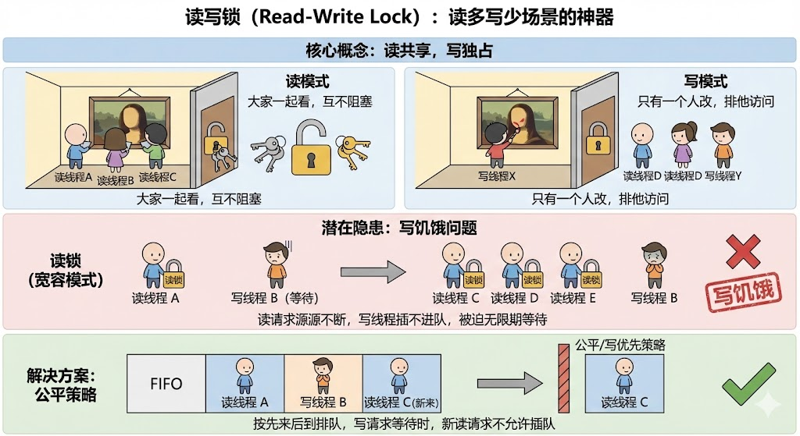

读写锁（Read-Write Lock），顾名思义，就是把“读”和“写”区别对待的锁。

简单来说：**它允许大家一起看（读共享），但只许一个人改（写独占）。**

它是一个典型的**性能优化**工具。在大多数业务场景里，看数据的人总比改数据的人多得多。如果为了那 1% 的写操作，让 99% 的读操作也都排队，那就太不划算了。

具体的使用场景和它自带的“副作用”，可以从以下三个方面来回答：

1. **适用场景：读多写少**
- **核心逻辑：** 互斥锁（Mutex）是“不管你在干嘛，同一时间只能有一个人进屋”。读写锁则是：“如果你只是来看画的，可以一堆人一起进屋看；但如果你要拿起画笔改画，那必须把屋里清空，只有你一个人能进”。
- **经典案例：**
    - **配置中心（Config）：** 配置信息通常很久才改一次，但成千上万个服务每秒钟都要去读取配置。
    - **缓存黑白名单：** 黑名单列表很少变动，但每个请求都要去查一下“我在不在名单里”。
    - **路由表****：** 路由器查表转发数据包极其频繁，但更新路由表很低频。
1. **潜在隐患：写饥饿**
- **现象：** 假设读锁是“宽容模式”（只要有读锁在，新的读请求就能加塞进来）。
    - 线程 A 在读（拿着读锁）。
    - 线程 B 想写（等着，进不去）。
    - 这时，线程 C 又来读。因为 A 还在读，系统允许 C 也进去读。
    - 线程 D、E、F... 源源不断地来读。
- **结果：** 只要读请求不断，写线程 B 就永远找不到一个“没有任何人在读”的空隙。它会一直被无限期搁置，活活饿死。这就是**写饥饿**。
1. **解决方案：公平锁策略**
- 为了解决写饥饿，现代的读写锁通常提供“公平模式”**或**“写锁优先”机制。
- **逻辑：** 一旦有写线程在排队，后面新来的读线程，不管现在锁是不是空闲的，都**不允许插队**，必须乖乖排在写线程后面。

---

### 面试标准回答

读写锁主要用于‘读多写少’**的高并发场景，它的核心优势是**打破了互斥锁在‘读-读’操作上的不必要互斥，从而极大地提升了系统的并发吞吐量。

具体的适用场景：

比如配置管理、黑白名单检测、商品详情页查询等。这些场景的特点是：数据修改频率极低，但读取频率极高。使用读写锁可以让多个读线程并行执行，互不阻塞。

但是，读写锁可能会导致‘写饥饿’问题：

如果读写锁采用的是读优先（非公平）策略，且读请求非常密集，源源不断地进入，那么写线程可能永远无法获得锁，因为它必须等待所有读锁释放。这就导致写线程长时间阻塞，甚至饿死。

**解决办法通常有两种**：

1. **使用公平锁（Fair Lock）**：比如 Java 的 `ReentrantReadWriteLock` 可以设置为公平模式。它会强制按照请求的先后顺序排队，不管是读还是写，都得先来后到。
2. **使用写优先策略**：一旦有写请求在等待，后续新来的读请求就不允许再抢占锁了，必须排队，直到写操作完成。
