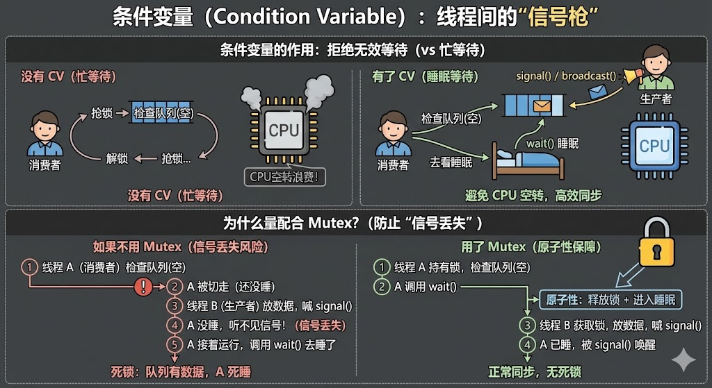

条件变量（Condition Variable），用大白话讲，就是线程之间的“信号枪”**或**“电话机”。

互斥锁（Mutex）解决的是“谁能进房间”**的问题（互斥），而条件变量解决的是**“什么时候进房间”的问题（同步）。

它的核心作用就是：**让线程在条件不满足时乖乖睡觉（释放 CPU），等条件满足了再被别的线程唤醒，而不是在那傻傻地空转（忙等待）。**

具体逻辑如下：

1. **条件变量的作用：拒绝无效等待**
- **场景：** 经典的生产者-消费者模型。消费者想取数据，发现队列是空的。
- **没有 CV 时：** 消费者只能写个 `while` 循环，一遍一遍地抢锁、检查队列、解锁。这叫忙等待，CPU 全被浪费在“检查空队列”这件事上了。
- **有了 CV 后：** 消费者发现队列空了，直接调用 `wait()`，把自己挂起（进入睡眠队列），不占 CPU 了。等生产者放了数据，调用 `signal()` 或 `broadcast()`，消费者才会被叫醒继续干活。
1. 为什么要配合 Mutex？（防止“信号丢失”）

这是面试最爱问的深坑。很多人以为 Mutex 只是为了保护共享数据，其实更重要的是为了保证“检查条件”和“进入睡眠”这两个动作的原子性。

- **如果不用 Mutex 会怎样？（死锁风险）**
    - 线程 A（消费者）检查队列，发现是空的。
    - **就在这一瞬间**，线程 A 的时间片到了，被切走了（还没来得及调用 `wait` 睡觉）。
    - 线程 B（生产者）进来了，往队列放了个数据，并大喊一声 `signal`（叫醒正在睡觉的人）。
    - **关键点：** 此时线程 A 还没睡呢！所以它根本听不见这声 `signal`。
    - 轮到线程 A 运行了，它记得“刚才看队列是空的”，于是它放心地调用 `wait` 去睡觉了。
    - **结果：** 队列里明明有数据，但线程 A 完美错过了通知，在那死睡，造成逻辑死锁。
- **用了 Mutex 会怎样？**
    - 条件变量的 `wait()` 方法设计非常精妙：**它要求你调用时必须持有锁**。
    - 在 `wait()` 内部，它会**原子性地**完成“释放锁”和“进入睡眠”这两件事。这就确保了不可能有其他线程插队在“你决定睡”和“你真的睡着”之间发送信号。

---

### 面试标准回答

条件变量主要用于实现**线程间的同步**，即让线程在不满足特定条件时挂起（阻塞等待），而在条件满足时被唤醒，从而避免了忙等待带来的 CPU 资源浪费。

**它必须配合 Mutex 使用，主要基于两个核心原因：**

第一，保护共享状态（基础原因）：

条件变量通常是伴随着共享数据（如队列的 count）一起使用的。线程在判断‘条件是否满足’时，就是在访问共享数据，因此必须加锁来防止竞态条件。

第二，防止‘丢失唤醒’（Lost Wake-up）问题（核心原因）：

如果没有 Mutex 的保护，线程在‘判断条件’和‘调用 wait 挂起’之间存在时间间隙。

如果在这个间隙内，另一个线程修改了条件并发送了 signal 信号，那么当前的线程因为还没挂起，就会错过这个信号，然后接着去休眠，导致永远无法被唤醒。

机制保障：

条件变量的 wait 操作是原子性的。它会在进入休眠的同时释放 Mutex，确保了在‘判断条件’到‘真正休眠’的整个过程中，没有其他线程能插进来改变状态并发送信号。
