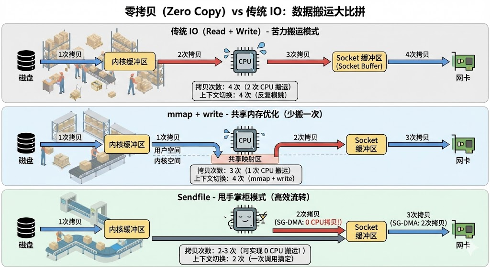

零拷贝（Zero Copy），说白了就是“别让 CPU 干搬运工的苦力活”。

在传统的文件传输中，CPU 大部分时间都在把数据从“左手倒右手”（从内核读出来，拷给用户程序，用户程序再拷回内核发出去）。零拷贝的核心目标，就是**消除这些多余的数据拷贝和上下文切换**，让 CPU 腾出手来做计算，让数据直接在内核里“溜”出去。

为了讲清楚 `mmap` 和 `sendfile` 到底牛在哪，我们先得看看“传统 IO”：

1. 传统 IO（Read + Write）

如果你要把磁盘上的一个文件发给网卡：

1. **Read：** 数据从磁盘 -> 内核缓冲区 -> **用户缓冲区**。
2. **Write：** 数据从 **用户缓冲区** -> 内核 Socket 缓冲区 -> 网卡。
- **代价：** 数据被拷贝了 **4 次**（其中 2 次是 CPU 亲自搬运），上下文切换了 **4 次**（用户态和内核态反复横跳）。
1. **mmap + write：****共享内存****（少搬一次）**
    1. **原理：**`mmap` 把内核缓冲区的数据**直接映射**到用户空间。
    2. **怎么省的：** 用户程序不需要把数据从内核“拷贝”到自己的内存里了，它直接读那个映射的地址就行。
    3. **效果：**
        - **拷贝次数：** 变成了 **3 次**。省去了（内核 -> 用户）的那次 CPU 拷贝。但（用户 -> Socket）这一步还得 CPU 搬运。
        - **切换次数：** 依然是 **4 次**。因为你还是得先调 `mmap`，再调 `write`。
2. **Sendfile**
    1. **原理：** 用户程序直接对内核说：“把 A 文件发给 B Socket，你自己搞定，别经过我的手”。
    2. **怎么省的：** 数据直接在内核里流转（磁盘 -> 内核缓冲区 -> Socket 缓冲区 -> 网卡），压根不进用户空间。
    3. **效果：**
        - **拷贝次数：** 变成了 **3 次**（如果网卡支持 SG-DMA 技术，可以进一步减到 **2 次**，真正实现 **0 CPU 拷贝**）。
        - **切换次数：** 变成了 **2 次**。因为只需要调用一次 `sendfile` 函数就搞定了。

---

### 面试标准回答

零拷贝（Zero Copy）是一种通过减少数据在内存中的冗余拷贝次数，以及减少用户态与内核态上下文切换次数，来提升 I/O 性能的技术。

**传统 I/O（Read/Write）** 存在严重的性能损耗，它需要 **4 次上下文切换** 和 **4 次数据拷贝**（其中 2 次是 CPU 拷贝）。

**针对这一问题，主要有两种常见的优化方案：**

**第一，mmap（内存映射）**：

- **原理**：利用虚拟内存技术，将内核缓冲区的数据直接映射到用户空间，使内核和用户进程共享同一块物理内存。
- **优化点**：它减少了 **1 次 CPU 拷贝**（不需要将数据从内核态拷到用户态），但依然需要 **4 次上下文切换**（因为需要 mmap 和 write 两次系统调用）。

**第二，Sendfile**：

- **原理**：这是一种专门用于文件传输的系统调用。数据根本不经过用户态，直接在内核内部从读取缓冲区传输到 Socket 缓冲区。
- **优化点**：
    - 它将上下文切换减少到了 **2 次**。
    - 在标准模式下，它需要 3 次拷贝。
    - 如果网卡支持 **SG-DMA（Scatter-Gather DMA）**，sendfile 可以实现真正的 **0 CPU 拷贝**（数据只在硬件之间传输，CPU 仅传输描述符），最终只有 **2 次 DMA 拷贝**。

**总结**：mmap 适合小数据量读写，而 sendfile 适合大文件传输（如 Kafka、Nginx 静态资源）。
