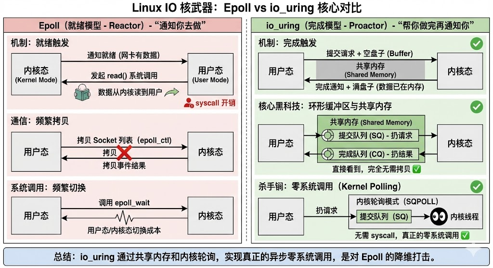

简单总结：**Epoll 是“通知你去做”，io_uring 是“帮你做完再通知你”。**

Epoll 还需要使用系统调用去读写数据，而 io_uring 直接打通了应用和内核的“秘密通道”（共享内存），实现了真正的**零系统调用**和**异步完成**模式，是对 Epoll 的一次降维打击。

具体的核心优势和原理，可以从这三个维度来理解：

1. **机制差异：就绪模型 vs 完成模型**
    1. **Epoll (Reactor)：** 它是“就绪触发”。内核告诉你“网卡有数据了，快来读”。然后你必须暂停手里的活，发起 `read()` 系统调用，把数据从内核读到用户态。这中间还是有 syscall 开销。
    2. **io_uring (Proactor)：** 它是“完成触发”。你直接把空盘子（Buffer）扔给内核，说“把数据填满”。内核悄悄把活干完，把装满数据的盘子还给你。你拿到的时候，数据已经在你的内存里了。
2. **核心黑科技：环形缓冲区（Ring Buffer）与共享内存**
    1. **痛点：** Epoll 每次要把感兴趣的 Socket 列表从用户态拷贝到内核态（`epoll_ctl`），事件触发后又要把结果拷贝回来。
    2. **解决：** io_uring 在用户态和内核态之间划了一块**共享内存**，里面放了两个环形队列：
        - **提交队列（SQ）：** 你往里扔请求。
        - **完成队列（CQ）：** 内核往里扔结果。
    3. 因为是共享内存，大家都能直接看到，**完全不需要拷贝指令数据**。
3. **杀手锏：零系统调用（Kernel Polling）**
    1. **Epoll：** 即使再快，你还是得调 `epoll_wait`，这还是个系统调用，要在用户态和内核态之间切来切去。在极高并发下（比如百万 QPS），这个切换成本非常可观。
    2. **io_uring：** 它可以开启**内核轮询模式（SQPOLL）**。内核会启动一个线程专门盯着提交队列，只要你往队列里扔了请求，内核立马就拿去处理。应用层连 `syscall` 都不用发，实现了真正的**零系统调用**。

---

### 面试标准回答

`io_uring` 是 Linux 5.1 引入的新一代异步 I/O 接口，旨在解决 Epoll 在极高并发场景下的性能瓶颈。它与 Epoll 的区别主要体现在以下三点：

**第一，核心模型不同（从 Reactor 到 Proactor）**：

- **Epoll** 属于**就绪模型**。它只通知‘何时可以读写’，真正的读写操作（IO copy）依然需要应用程序发起系统调用来完成，本质上还是同步非阻塞。
- **io_uring** 属于**完成模型**。应用程序只需提交请求，内核负责处理所有的 IO 操作（包括将数据拷贝到用户缓冲区），完成后通知应用。这是真正的**异步 I/O**。

**第二，通信机制不同（减少系统调用）**：

- Epoll 需要依赖 `epoll_ctl` 和 `epoll_wait` 等系统调用，频繁在用户态和内核态之间切换。
- io_uring 利用**两个基于共享内存的环形队列（Submission Queue 和 Completion Queue）来实现用户态与内核态的通信。这使得提交请求和获取结果无需进行数据拷贝**。

**第三，支持内核轮询（Zero Syscall）**：

- io_uring 支持 **SQPOLL** 模式。开启后，内核会启动内核线程轮询提交队列。这意味着应用程序提交 IO 请求时，**甚至不需要发起任何系统调用**，彻底消除了上下文切换的开销。
