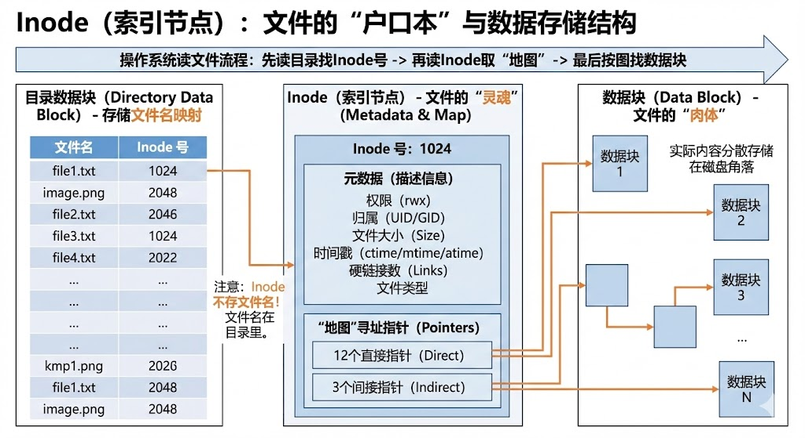

Inode，全称 **Index Node（索引节点）**。简单来说，它是文件的“户口本”**或**“身份证”。

在 Linux/Unix 系统里，文件的数据和文件的属性（元数据）是分家存储的：

- **数据（Data）：** 存在普通的数据块（Data Block）里，那是文件的肉体。
- **属性（Metadata）：** 存在 **Inode** 里，那是文件的灵魂。

这里有个最反直觉的设计：**Inode 里存了关于这个文件的一切，但唯独不存“文件名”。**（文件名存在“目录”的数据块里）。

具体来说，Inode 主要存储了以下两类核心信息：

1. 文件的“元数据”（描述信息）

也就是 ls -l 命令能看到那一堆东西：

- **权限信息：** 读、写、执行权限（rwx）。
- **归属信息：** 拥有者的 ID（UID）和所属组的 ID（GID）。
- **文件大小：** 也就是 Size（字节数）。
- **时间戳：**
    - `ctime`：Inode 信息变更时间。
    - `mtime`：文件内容修改时间。
    - `atime`：最近一次访问时间。
- **硬链接数（Links）：** 有多少个文件名指向这个 Inode。
- **文件类型：** 是普通文件、目录，还是软链接等。
1. 文件的“地图”（寻址指针）

这是 Inode 最重要的功能。它里面有 12 个直接指针（Direct Pointers）和 3 个间接指针（Indirect Pointers）。

- **作用：** 它们记录了“这个文件的实际内容到底存在磁盘的哪个 Block 里”。
- 操作系统读文件时，先读 Inode，拿着这张“地图”，才能找到分散在磁盘各个角落的数据块。

---

### 面试标准回答

Inode（索引节点）是 Unix/Linux 文件系统中用于描述文件属性的**核心数据结构**。它是文件系统中的唯一标识（通过 Inode Number 索引）。

**Inode 存储了文件的元数据和数据块指针，具体包含以下内容：**

1. **权限与归属**：包括读写执行权限（Mode）、文件所有者（UID）和用户组（GID）。
2. **文件状态**：包括文件大小（Size）、硬链接数量（Link Count）以及三个关键时间戳（Access, Modify, Change time）。
3. **数据块指针（最重要的部分）**：它包含指向文件实际数据块（Data Block）的指针。通过直接指针和多级间接指针，操作系统可以定位到文件在磁盘上的物理位置。

特别注意（加分项）：

Inode 中不存储文件名。文件名是存储在目录的数据块（Directory Entry）中的。目录本质上是一张‘文件名 -> Inode 号’的映射表。
