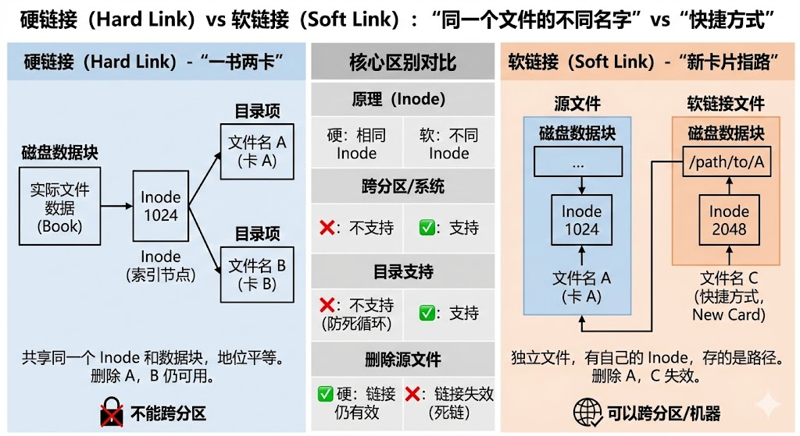

硬链接和软链接，说白了就是“同一个文件的不同名字”**和**“指向文件的快捷方式”的区别。

本质上，它们的区别在于**对** **Inode****（****索引节点****）的处理方式不同**。

我们可以把文件系统想象成一个巨大的图书馆：

- **硬链接**就像是一本书有两张检索卡（卡 A 和卡 B），它们上面的编号（Inode 号）是一样的，指向书架上同一本书。你撕了卡 A，书还在，必须把所有卡都撕了，书才会被销毁。
- **软链接**就像是一张新卡片，上面没写书的位置，只写了“去看卡 A”。如果你把卡 A 撕了，这张新卡片就废了（死链），因为它指向的东西没了。

具体区别主要体现在这 4 个维度：

1. **原理不同（****Inode** **是否相同）**
- **硬链接****：** 多个文件名指向**同一个** **Inode**。它们地位完全平等，没有主次之分。
- **软链接****：** 是一个全新的文件，有**自己的** **Inode**。它的内容里存的是另一个文件的**路径**。
1. **跨分区/文件系统**
- **硬链接****：****不能跨分区**。因为 Inode 编号只在同一个分区内唯一，跨了分区 Inode 号就重复了，指不到正确的地儿。
- **软链接：****可以跨分区**，甚至可以跨机器（网络文件系统）。因为它存的是路径字符串。
1. **对目录的支持**
- **硬链接：****不支持目录**（为了防止文件系统出现环路死循环，只有超级用户在极特殊情况下能做，但一般认为不支持）。
- **软链接：****支持目录**。我们经常用软链把一个深层目录映射到方便的位置。
1. **删除源文件的后果**
- **硬链接：** 删除源文件名，硬链接**不受影响**（除非它是最后一个链接）。因为只是链接数（Link Count）减 1。
- **软链接：** 删除源文件，软链接**失效**（变成 dangling link），再访问会报错“文件不存在”。

---

### 面试标准回答

硬链接和软链接是 Linux 文件系统中两种不同的链接方式，它们最核心的区别在于**是否共享 Inode**：

**第一，硬链接（Hard Link）**：

- **本质**：它是同一个文件实体的**不同别名**。硬链接与源文件共享**同一个 Inode** 和数据块。
- **特点**：删除源文件，硬链接依然可以正常访问（除非硬链接计数降为 0）。
- **限制**：硬链接**不能跨越文件系统（分区）**，且通常**不允许链接目录**（为了防止循环引用）。

**第二，软链接（Symbolic Link）**：

- **本质**：它是一个**独立的文件**（拥有独立的 Inode）。其数据块中存储的是指向目标文件的**路径字符串**（类似 Windows 的快捷方式）。
- **特点**：如果删除了源文件，软链接就会**失效**（Broken Link）。
- **优势**：软链接**可以跨文件系统**，也可以**链接目录**，使用更加灵活。
