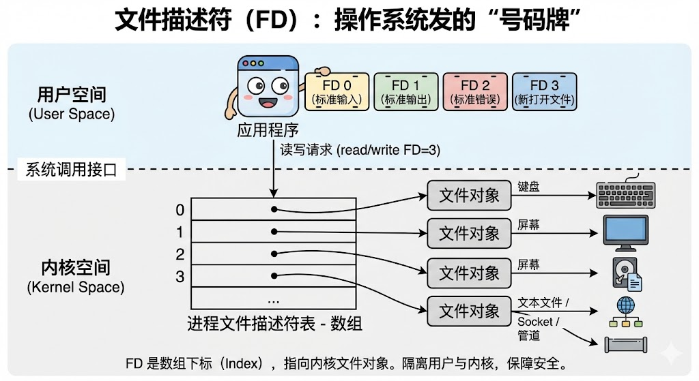

文件描述符（File Descriptor，简称 FD），说白了就是一个“非负整数”（0, 1, 2, ...）。

它是操作系统发给应用程序的一个“号码牌”。因为 Linux 奉行“一切皆文件”的哲学，不管是你打开一个文本文件、创建一个网络 Socket、还是建立一个管道，操作系统都不会把真正的内核对象（指针）给你，而是给你这个整数 ID。

以后你要读写这个文件，就把这个 ID 扔给操作系统，操作系统查表就能找到对应的文件。

具体的逻辑和细节可以从这三个维度来理解：

1. **本质：数组的索引（Index）**
- 在内核里，每个进程都有一个“文件描述符表”（File Descriptor Table）。这其实就是一个**数组**。
- 这个数组里的每一项，都存了一个指针，指向系统级打开的文件对象（File Object）。
- **FD** **就是这个数组的下标**。比如操作系统给了你 FD=3，意思就是：“你要找的文件，在我这个数组的第 3 号位置上”。
1. **作用：内核与用户的隔离墙**
- **安全：** 操作系统不能把内核内存地址（指针）直接暴露给用户程序，否则你瞎改指针系统就崩了。
- **抽象：** 用一个简单的整数 ID 来代替复杂的底层结构（inode、磁头位置、缓冲区状态），让编程更简单。
1. **默认的三个“元老”**
- 每个进程启动时，默认都会自动打开三个 FD：
    - **0 (Standard Input)：** 标准输入（通常是键盘）。
    - **1 (Standard Output)：** 标准输出（通常是屏幕）。
    - **2 (Standard Error)：** 标准错误（通常也是屏幕）。
- 所以你平时写的 `open()` 打开新文件，返回的 FD 通常是从 **3** 开始的。

---

### 面试标准回答

文件描述符（File Descriptor）是 Linux 内核为了高效管理已打开文件所创建的一种索引。

**从表现形式上看**：它是一个**非负整数**。

从底层原理上看：

Linux 中的每个进程都维护着一张文件描述符表（本质上是一个指针数组）。

当进程打开一个文件、创建 Socket 或管道时，内核会在该表中分配一个空闲项来记录文件信息，并将该项的**数组下标（Index）**作为文件描述符返回给用户进程。

**它的核心意义在于**：

1. **屏蔽底层细节**：用户态只需要持有这个 ID，而不需要关心文件在磁盘上的物理位置或内核中的内存结构。
2. **通用性**：Linux 中‘一切皆文件’，所有的 IO 资源（文件、网络、设备）都统一通过文件描述符进行读写操作。
