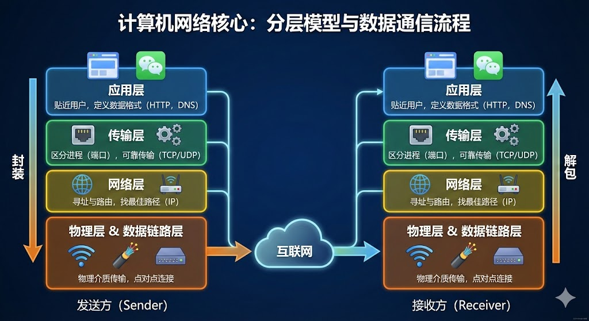

计算机网络这门课，核心就讲一件事：**分散在世界各地的计算机，如何通过既定的规则（协议）连接起来，并准确、高效地交换数据。**

为了解决这个复杂的通信问题，计算机网络主要采用“**分层模型**”（通常是 TCP/IP 五层模型或 OSI 七层模型）来解构整个网络体系。

1. **物理层与数据链路层**

这是网络的最底层。主要讲数据如何在物理介质（如光纤、双绞线、无线电波）上传输，以及两台直连的设备（比如你的电脑和路由器）之间如何识别对方。

1. **网络层**

当数据离开局域网，需要跨越茫茫互联网到达另一端的服务器时，如何找到最佳路径？这一层解决了“主机到主机”的通信问题。

1. **传输层**

网络层只负责把数据送到对方电脑，但电脑上有很多程序（微信、浏览器、游戏），数据到底该给谁？传输层通过“端口”来区分进程。同时，它还要处理数据丢了怎么办、发太快了怎么办。

1. **应用层**

这是最贴近用户的一层。讲的是我们日常使用的软件是如何定义数据格式的。

### 面试标准回答

这门课就是围绕着‘协议栈’，讲数据是如何被层层封装发送，又是如何被层层解包还原的完整过程

计算机网络这门课，核心研究的是**分布式软硬件系统如何实现互联和通信**的问题。

从宏观上看，它主要讲的是**网络分层模型**（也就是 TCP/IP 五层或 OSI 七层模型）。这门课通过分层思想，将复杂的通信问题解耦成了几个独立的子问题。

具体来说，它解决了四大核心问题：

**物理连通与局域网通信**：即物理层和数据链路层，解决最底层的信号传输和点对点连接。

**寻址与路由**：即网络层，利用 IP 协议解决数据包在广域网中‘如何找到目标主机’的问题。

**端到端的可信传输**：即传输层，通过 TCP/UDP 协议，解决‘数据丢了怎么办、乱了怎么办’以及‘如何区分不同进程’的问题。

**应用与服务**：即应用层，定义了 HTTP、DNS 等标准协议，解决具体的业务交互格式。
