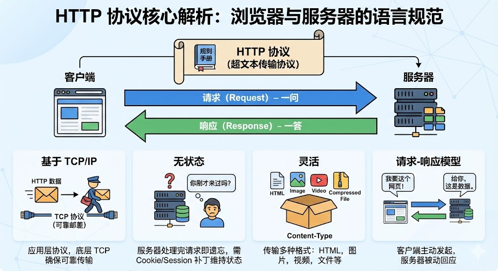

简单来说，HTTP 协议就是**浏览器和服务器之间沟通的“语言规范”**。

它的全称是超文本传输协议（HyperText Transfer Protocol）。你每天刷网页、看视频、刷手机 App，背后基本都是它在干活。它规定了客户端怎么发请求，服务器怎么回数据，保证大家能听懂对方的话。

具体来看，它有这么几个核心特点：

1. 请求 - 响应模型（一问一答）

HTTP 是典型的“客户端主动，服务器被动”。服务器不会主动找你，必须是你发起一个 Request（请求），服务器才给你回一个 Response（响应）。

1. 基于 TCP/IP

HTTP 属于应用层协议，它就像是写在纸上的信，而负责把信送到的邮差是底层的 TCP 协议。这意味着 HTTP 传输是可靠的，数据一般不会丢。

1. 无状态

这是 HTTP 最大的特点。服务器处理完你的请求就“翻脸不认人”了，它不知道你刚才来过。所以为了让你登录后能保持状态，后来才打上了 Cookie 和 Session 这些“补丁”。

1. 灵活

虽然名字叫“超文本”，但它实际上啥都能传：HTML、图片、视频、压缩包，只要定义好 Content-Type 就能运。

### 面试标准回答

“HTTP 协议，全称超文本传输协议，它是互联网上应用最为广泛的一种网络协议。

从三个维度来定义它：

**第一，从架构上看**，它是属于**应用层**的协议，底层通常基于 **TCP** 协议来实现可靠传输（HTTP/3 基于 UDP）。

**第二，从工作模式上看**，它是基于**请求-响应**（Request-Response）模式的。也就是客户端发起请求，服务器回送响应，通信结束后连接通常会断开（或者保持 Keep-Alive）。

**第三，从特性上看**，它是一种**无状态**（Stateless）的协议。这意味着协议本身不保留之前一切的请求或响应信息。为了解决这个问题，在实际开发中我们通常配合 Cookie 和 Session 来管理用户状态。
