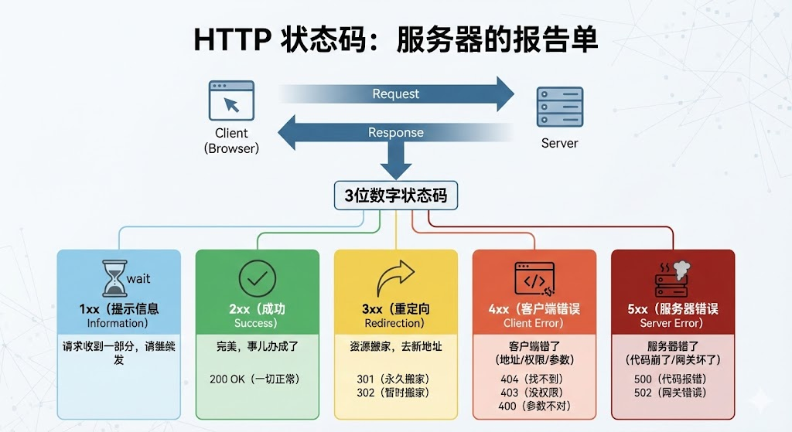

HTTP 状态码说白了就是**服务器给浏览器发的一个报告**。

当你给服务器发请求时，它除了给你数据，还得告诉你这事儿办得怎么样：是办成了、没办成，还是得去别的地方办。这个结果就用一个 3 位数字来表示。

为了好记，我们通常看**第一个数字**就能知道大概情况（核心原则就是看**问题出在哪**）：

1. **1xx（提示信息）：** 意思是“由于某些原因，请求收到了一部分，你继续发”。平时开发见得比较少。
2. **2xx（成功）：** 意思是“完美，事儿办成了”。
    1. 最典型的就是 **200 OK**（一切正常）。
3. **3xx（重定向）：** 意思是“资源搬家了，你去新地址找吧”。
    1. 核心区别：**301** 是永久搬家（以后别来老地址了），**302** 是暂时搬家（下次还来老地址）。
4. **4xx（客户端错误）：** 意思是**客户端**错了。
    1. 要么是你地址填错了（**404**），要么是你没权限（**403**），要么是你参数传得不对（**400**）。
5. **5xx（服务器错误）：** 意思是**服务器**错了。
    1. 代码崩了（**500**），或者网关坏了（**502**）。

---

### 面试标准回答

HTTP 状态码是由 3 位数字组成的，用来表示服务器对请求的处理结果。按照第一个数字的不同，通常分为五大类：

1. **1xx（信息性状态码）**：表示接收的请求正在处理。
2. **2xx（成功状态码）**：表示请求正常处理完毕。最常见的是 **200 OK**。
3. **3xx（重定向状态码）**：表示需要进行附加操作以完成请求。
    1. 重点要区分 **301 永久重定向**（资源已被永久移动）和 **302 临时重定向**（资源暂时移动）。
4. **4xx（客户端错误状态码）**：表示客户端发起的请求有问题，服务器无法处理。
    1. 常见有 **400 Bad Request**（请求参数有误）、**401 Unauthorized**（未认证/未登录）、**403 Forbidden**（有权限但被禁止/鉴权失败）、**404 Not Found**（资源找不到）。
5. **5xx（服务器错误状态码）**：表示服务器处理请求时出错了。
    1. 常见有 **500 Internal Server Error**（服务器内部代码报错）、**502 Bad Gateway**（网关错误，通常是上游服务无响应）。
