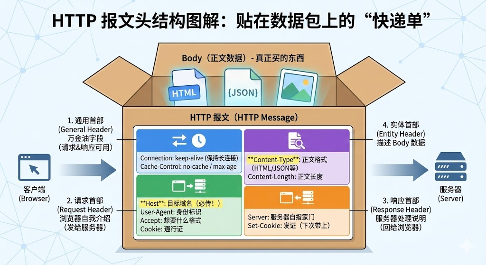

HTTP 报文头（Header）其实就是**贴在数据包上的“快递单”**。

里面的数据（Body）是你真正买的东西，而 Header 负责告诉服务器或浏览器：这东西是谁发的？发给谁的？里面装的是什么？要怎么处理？

虽然 HTTP 里的 Header 只有几十种，但为了不记混，我们通常按**功能**把它们分成四类：

1. 通用首部（General Header）

请求和响应都能用的“万金油”字段。

- **Connection**: 最常见的是 `keep-alive`，意思是“咱们连上了先别挂电话”，保持长连接，省得下次还得重新握手。
- **Cache-Control**: 控制缓存的，比如 `no-cache`（别缓存）或者 `max-age=3600`（缓存一小时）。
1. 请求首部（Request Header）

浏览器发给服务器的“自我介绍”和“要求”。

- **Host**: **最重要的字段**（HTTP/1.1 唯一必传）。告诉服务器我想访问哪个域名（因为一个服务器IP上可能跑着好几个网站）。
- **User-Agent**: 告诉服务器我是谁（比如我是 Chrome 还是爬虫脚本）。
- **Accept**: 告诉服务器我想要什么格式的数据（比如 `application/json`）。
- **Cookie**: 也就是“通行证”，把本地存的身份信息带过去给服务器看。
1. 响应首部（Response Header）

服务器回给浏览器的“处理说明”。

- **Server**: 服务器自报家门（比如我是 Nginx 还是 Apache）。
- **Set-Cookie**: 服务器给浏览器发证，“下次来记得带上这个 ID”。
1. 实体首部（Entity Header）

专门描述 Body（正文）数据的字段。

- **Content-Type**: **最核心字段**。告诉对方正文是啥格式（HTML、JSON 还是图片），不然对方没法解析。
- **Content-Length**: 正文有多长，方便对方知道读到哪里结束。

---

### 面试标准回答

面试时切忌报菜名一样把所有字段背一遍，**要分类阐述，并重点强调几个核心字段的作用**。

HTTP 报文头字段非常多，但在实际开发和面试中，通常将高频字段按**功能场景**分为四大类：

第一类是通用字段（请求和响应都有）：

最核心的是 Connection，通常设置为 keep-alive 来保持 TCP 长连接；还有 Cache-Control，用于控制强缓存和协商缓存策略。

第二类是请求字段（客户端发出的）：

这里最重要的是 Host，它是 HTTP/1.1 规范中唯一必须包含的字段，用于区分虚拟主机；其次是 User-Agent（标识客户端身份）、Accept（声明客户端支持的数据类型）以及用于维持会话的 Cookie。

第三类是响应字段（服务器回传的）：

常见的是 Set-Cookie，服务器通过它告知客户端保存 Cookie；还有 Server 字段表明服务器软件信息。

第四类是实体字段（描述数据本身的）：

面试中最常问的是 Content-Type，它决定了接收方如何解析数据（比如是 application/json 还是 text/html）；还有 Content-Length 标识数据长度，防止粘包问题。
