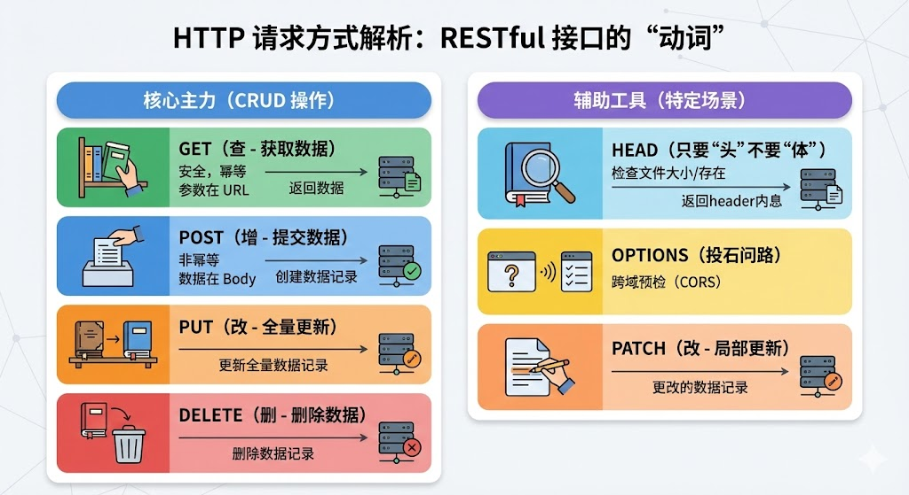

HTTP 请求方式，说白了就是**告诉服务器，你想对资源做什么？**。

在 RESTful 风格的接口设计中，这些请求方式就像是动词，对应着我们常说的“增删改查”操作。虽然协议里定义了很多种，但实际开发中用到最多的其实就那么几个。

我们可以把它们分成“核心主力”**和**“辅助工具”两类：

1. **核心主力（CRUD 操作）**
- **GET（查 - 获取数据）：** 最常用的。就像你去书架上拿本书看。
    - 特点：参数跟在 URL 后面，只读操作，不管发多少次都不会改变服务器上的数据（也就是**安全且幂等**的）。
- **POST（增 - 提交数据）：** 就像你去填一张表单交上去。
    - 特点：数据放在 Body（请求体）里，通常用来新增资源。发两次可能会导致生成两份数据（**非幂等**）。
- **PUT（改 - 全量更新）：** 就像你把书架上的一本书拿走，换了一本新的放回去。通常用于更新整个资源。
- **DELETE（删 - 删除数据）：** 很直白，就是把这个资源删掉。
1. **辅助工具（特定场景）**
- **HEAD：** 和 GET 几乎一样，但**只要“头”不要“体”**。
    - 场景：比如你想检查一个文件大不大、是否存在，但又不想真的把它下载下来，就用 HEAD。
- **OPTIONS：** 投石问路。
    - 场景：主要用于**跨域请求（CORS）**前的预检。浏览器会先发一个 OPTIONS 问问服务器：“哎，你支持跨域吗？支持哪些方法？”服务器点头了，浏览器才会发真正的请求。
- **PATCH：** 也是“改”，但属于**局部更新**。
    - 场景：PUT 是把整条数据覆盖，PATCH 是只改其中的某一个字段。

---

### 面试标准回答

面试官问这个问题，通常是想看你有没有**RESTful API 设计的意识**，以及是否了解 **GET 和 POST 的核心区别**。

HTTP 请求方法主要用来定义对资源的操作行为。

**最常用的主要是这四种，对应着业务中的增删改查（CRUD）：**

1. **GET**：用于**获取**资源。它是安全且幂等的，参数通常拼接在 URL 中。
2. **POST**：用于**提交/新建**资源。它不是幂等的，数据通常封装在 Request Body 中。
3. **PUT**：用于**更新**资源（通常指全量替换）。
4. **DELETE**：用于**删除**资源。

**除了这些，还有几个常用的辅助方法：**

- **HEAD**：类似于 GET，但服务器只返回响应头，不返回响应体。常用于健康检查或文件大小检测，比较节省带宽。
- **OPTIONS**：用于获取服务器支持的通信选项。最典型的场景是在**跨域请求（CORS）**中作为‘预检请求’，确认服务端是否允许跨域。
- **PATCH**：用于对资源进行**局部修改**（区别于 PUT 的整体替换）。
