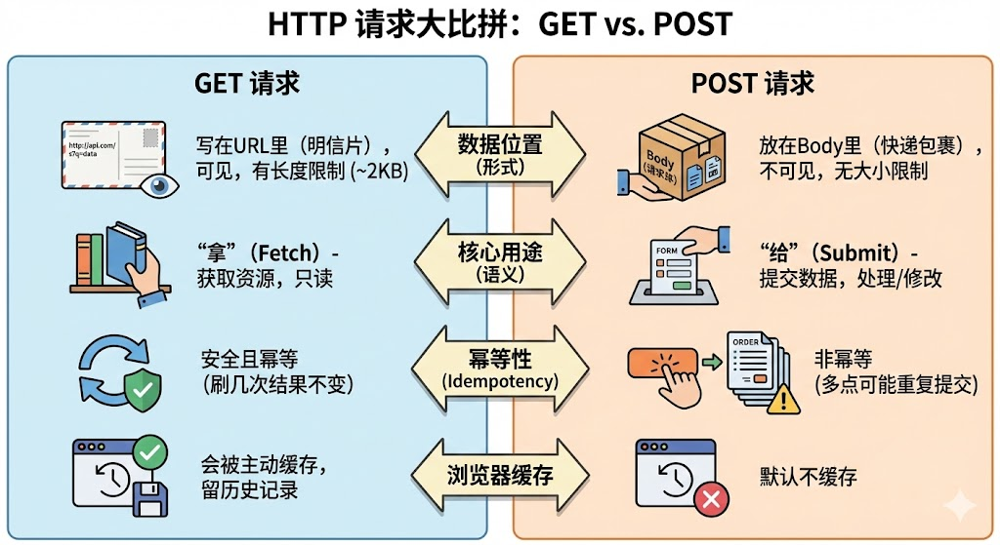

虽然它们本质上都是通过 TCP 链接运送数据，但在用法和特点上有很大的不同。

简单来说，它们的区别主要体现在这几个方面：

1. **数据放哪儿？（形式上的区别）**
- **GET**：把数据写在**URL**里（地址栏）。就像明信片，内容直接写在背面，谁都能看见。这也导致了它传不了太大的数据（因为浏览器对 URL 长度有限制，一般 2KB 左右）。
- **POST**：把数据放在**Body**（请求体）里。就像快递包裹，东西是装在盒子里的。所以它理论上没有大小限制，想传多大传多大（只要服务器受得了）。
1. **用来干嘛？（语义上的区别）**
- **GET**：顾名思义是“拿”**。主要是向服务器查询或获取资源。它是**只读的。
- **POST**：意思是“给”。主要是向服务器提交数据，让服务器去处理（比如存进数据库）。
1. **幂等性**
- **GET**：是**安全且幂等**的。不管你刷多少次 GET 请求，服务器上的数据都不会变，结果都是一样的。
- **POST**：是**非幂等**的。你手抖多点了几次提交按钮，可能就会在数据库里产生好几条重复订单。
1. **缓存**
- 浏览器很喜欢缓存 **GET** 请求（因为它是只读的，存下来下次加载快），但默认不会缓存 **POST** 请求。

---

### 面试标准回答

GET 和 POST 是 HTTP 协议中最常用的两种请求方法，它们的区别主要体现在三个层面：

**第一，从规范和语义上看**：

- **GET** 用于**获取**资源，它是**安全且幂等**的。
- **POST** 用于**提交**或者**修改**资源，它**不是幂等**的。

**第二，从数据传输细节上看**：

- **GET** 的参数是拼接在 **URL** 后面进行传递的，因此受限于浏览器对 URL 长度的限制（通常 2KB 左右），且参数直接暴露在地址栏，**不适合传输敏感数据**。
- **POST** 的参数是放在 **Request Body** 中传递的，理论上没有长度限制，且支持多种数据格式（如 JSON、XML、文件等）。

**第三，从浏览器行为上看**：

- **GET** 请求会被浏览器**主动缓存**，且会保留在历史记录中。
- **POST** 请求默认**不会被缓存**。
