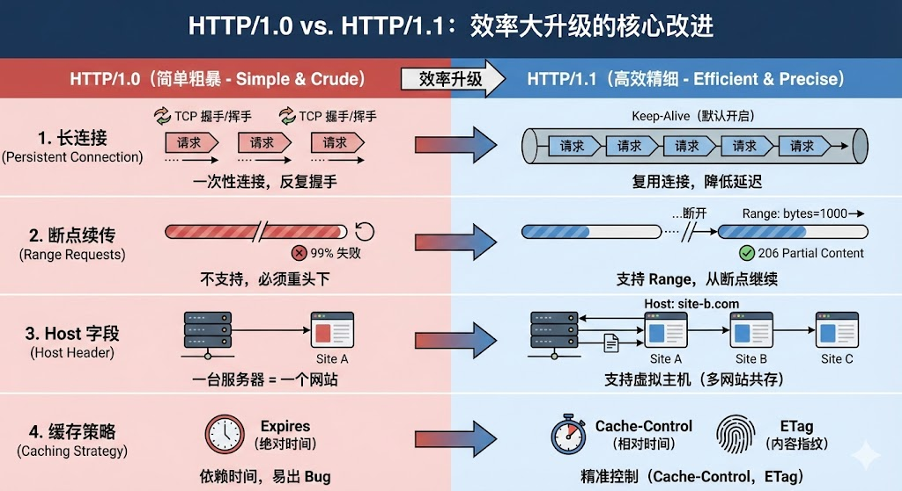

HTTP/1.1 相比于 1.0，核心就为了解决一个问题：**效率**。

1.0 时代，网络太慢，协议设计得比较简单粗暴。到了 1.1，为了适应更大的流量和更复杂的网页，主要做了“连接复用”**和**“精细化控制”这两个层面的大升级。

具体改进主要体现在这四个方面：

1. 长连接

在 HTTP/1.0 里，TCP 连接是“一次性”的，发一个请求就断开，想发下一个还得重新握手，效率极低。

HTTP/1.1 默认开启了 Keep-Alive（长连接）。只要建立一次 TCP 连接，就可以在这条“管道”里连续发送多个请求，不用反复握手挥手，大大降低了延迟。

1. 断点续传

HTTP/1.1 引入了 Range 头。

以前 1.0 下载文件，要是下到 99% 断网了，必须重头开始下。1.1 支持只请求文件的一部分（比如从第 1000 个字节开始传），这就实现了断点续传，状态码是 206 Partial Content。

1. Host 字段

HTTP/1.0 认为一台物理服务器对应一个域名。但后来一台服务器上可能跑着好几个网站。

HTTP/1.1 强制要求请求头里必须带上 Host 字段，告诉服务器你到底要访问哪一个网站，否则服务器就不知道把请求分发给谁。

1. 缓存策略

HTTP/1.0 主要靠 Expires（绝对时间）来做缓存，容易出 bug。

HTTP/1.1 引入了 Cache-Control（相对时间）、ETag（内容指纹）等字段，让缓存控制变得非常精准。

### 面试标准回答

HTTP/1.1 相比 HTTP/1.0，主要在连接方式、缓存控制和带宽优化上做了重大改进：

第一，默认开启长连接（Persistent Connection）：

HTTP/1.1 将 Connection: keep-alive 设为默认值。这意味着 TCP 连接在请求结束后不会立即关闭，可以被后续请求复用，大大减少了 TCP 三次握手和四次挥手的开销。

第二，支持 Host 头处理虚拟主机：

HTTP/1.1 规定请求头必须包含 Host 字段。这使得在同一台物理服务器上部署多个不同域名的网站（虚拟主机）成为可能。

第三，增强了缓存管理机制：

相比 1.0 主要依赖 Expires 和 Last-Modified，1.1 引入了 Cache-Control（优先级更高）和 ETag（基于内容摘要），提供了更灵活和准确的缓存策略。

第四，支持断点续传：

HTTP/1.1 在请求头中引入了 Range 字段，允许客户端只请求资源的一部分，服务器响应 206 Partial Content。这在下载大文件时非常有用。

**（补充）** 此外，HTTP/1.1 还尝试支持**管线化（Pipelining）**，即不等待响应就发送下一个请求，但由于‘队头阻塞’问题，在实际中应用并不广泛。”
