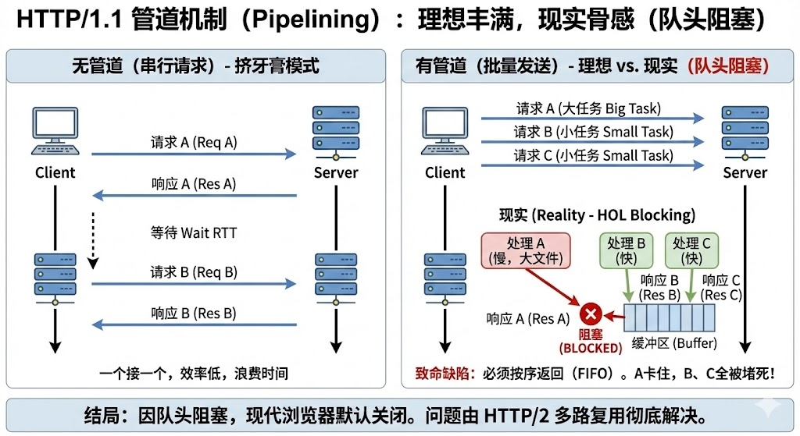

HTTP/1.1 的管道机制（Pipelining），用一句大白话解释就是：**“有话一次性说完，别挤牙膏”**。

在它之前，必须是“请求 A -> 响应 A -> 请求 B -> 响应 B”。有了管道机制，浏览器可以“请求 A -> 请求 B -> 请求 C”一股脑全发出去，然后等着服务器按顺序把 A、B、C 的结果回回来。

但这个机制在实际应用中非常尴尬，属于没有广泛落地的技术。

具体可以从以下三点来理解：

1. 核心原理：批量发送

它是建立在持久连接（Keep-Alive）基础上的。以前是发一个信等回信了再写下一封，管道机制允许你不用等回信，直接连发三封信过去。这在理论上能把网络延迟（RTT）挤干，填满带宽。

1. 致命缺陷：必须按序返回（FIFO）

这是最坑的地方。虽然你请求是连着发的，但服务器必须按照请求的顺序把结果发回来。

比如你发了 A、B 两个请求。A 是个很大的图片，传得很慢；B 是个只有几字节的文本，瞬间就处理好了。

但在 HTTP/1.1 的管道里，B 必须等 A 发完才能发。哪怕 B 早就准备好了，也得在缓冲区里憋着。

1. 队头阻塞（Head-of-Line Blocking）

正因为上面那个缺陷，一旦第一个请求卡住了（处理慢或者丢包），后面所有的请求全都被堵死。这反而可能导致体验更差。

所以，现代浏览器（Chrome、Firefox）为了稳定，默认基本都关闭了管道机制。真正解决这个问题，还是靠后来 HTTP/2 的“多路复用”。

### 面试标准回答

“HTTP/1.1 的管道机制（Pipelining）是指客户端可以在同一个 TCP 连接上，连续发送多个请求，而无需等待前一个请求的响应返回。

它的核心逻辑和局限性主要体现在两点：

第一，它实现了请求的‘并发发送’：

客户端可以一次性将请求队列中的数据发出，减少了网络延迟（RTT）带来的等待时间。

第二，但它受限于响应的‘顺序阻塞’：

HTTP/1.1 协议规定，服务器回送响应的顺序必须与接收请求的顺序严格一致。这意味着，如果第一个请求处理非常耗时（比如大文件传输或数据库慢查询），后续所有的响应——即使已经处理完毕——也都必须排队等待。

这就造成了著名的‘队头阻塞’（Head-of-Line Blocking）**问题。因为这个缺陷，管道机制在实际浏览器中应用并不广泛，目前主要通过 HTTP/2 的**多路复用技术来彻底解决这个问题。”
