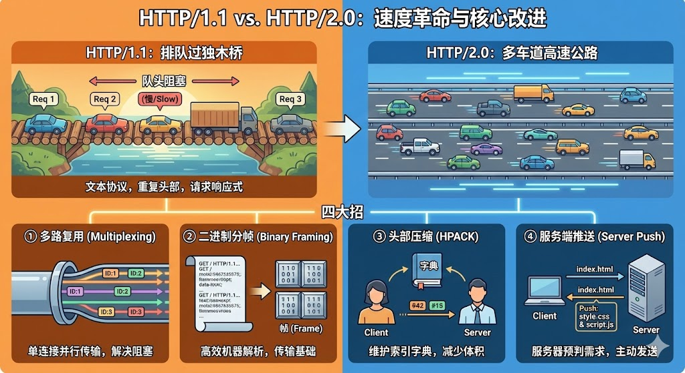

HTTP/2.0 的出现，本质上就是为了解决 HTTP/1.1 的排队问题。

它不是修修补补，而是把协议底层的“运输方式”**给彻底换了。如果说 HTTP/1.1 是一个个排队过独木桥，那 HTTP/2.0 就是把独木桥换成了**多车道的高速公路。

它的核心改进主要体现在这四个“大招”：

1. 多路复用（Multiplexing）

在 HTTP/1.1 里，虽然有长连接，但请求还是得一个接一个排队（队头阻塞）。

HTTP/2.0 允许在同一个 TCP 连接上，同时跑无数个请求和响应。大家混在一起发，谁快谁先到，不用互相等。

- **原理：** 给每个数据包打上“标签”（Stream ID），接收端收到一堆乱序的包，根据标签把它们重新拼好。
1. 二进制分帧（Binary Framing）

HTTP/1.1 是文本协议，你看报文都能直接读懂。但这对机器解析来说很慢，而且容易出错。

HTTP/2.0 彻底变成了二进制协议。它把数据切成一个个微小的二进制“帧”（Frame）。这也是实现多路复用的基础。

1. 头部压缩（Header Compression / HPACK）

HTTP/1.1 的 Header 常常很庞大，而且每次请求都要重复发一堆 User-Agent、Cookie，非常浪费带宽。

HTTP/2.0 用了 HPACK 算法。简单说就是浏览器和服务器双方都维护一张“字典”。第一次发过的内容，下次只要发一个索引号（比如用 1 代表 "Content-Type: text/html"），不用发全名，体积直接变小。

1. 服务端推送

以前是浏览器要一个，服务器给一个【请求响应式】。

现在服务器可以“预判”你的需求。比如你请求了 index.html，服务器知道你肯定还得要 style.css，就在回 HTML 的同时，顺手把 CSS 也推给你，省得你再发请求来要。

### 面试标准回答

HTTP/2.0 相比 1.1，在性能上有了质的飞跃，其核心改进可以总结为四个方面：

第一，实现了真正的多路复用（Multiplexing）：

解决了 1.1 中的‘队头阻塞’问题。HTTP/2 允许在同一个 TCP 连接上并发处理多个请求和响应。它通过引入 Stream ID 的概念，让不同请求的数据帧可以在线路上乱序发送，到达目的地后再组装，极大提高了连接利用率。

第二，采用二进制分帧（Binary Framing）：

HTTP/2 将协议从‘文本格式’改为了‘二进制格式’。它将所有传输信息分割为更小的帧（Frame）并进行二进制编码。这是实现多路复用和提升解析效率的基础。

第三，引入了头部压缩（HPACK 算法）：

在 1.1 中，header 往往携带大量重复数据（如 Cookie）。HTTP/2 在客户端和服务器端共同维护了动态字典和静态字典，后续传输只需要发送索引值，大大减小了报文体积。

第四，支持服务端推送（Server Push）：

服务器可以对客户端的一个请求发送多个响应。例如在客户端请求 HTML 时，服务器可以主动把相关的 CSS 和 JS 资源‘推’给客户端，减少了客户端的等待延迟。
