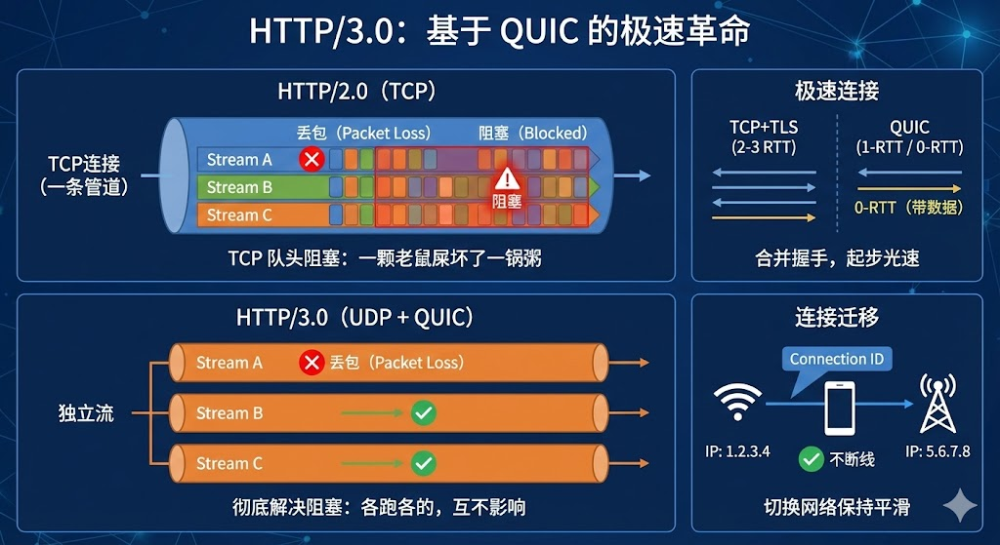

HTTP/3.0 的出现，其实就是为了解决 HTTP/2.0 问题——**TCP 协议的队头阻塞**。

简单来说，HTTP/2.0 虽然在应用层把数据拆开了，但底层运输还是靠 TCP。TCP 是个死板的协议，丢了一个包，后面的包即使到了也得等着，这导致 HTTP/2.0 在网络环境差（丢包率高）的时候，表现甚至不如 HTTP/1.1。

所以，HTTP/3.0 做了一个极其大胆的决定：**把** **TCP** **扔了，改用** **UDP**。

它基于 UDP 搞出了一个新协议叫 **QUIC**（Quick UDP Internet Connections），并在上面重建了一套机制。改进点主要集中在以下三个方面：

1. **彻底解决“****队头阻塞****”（这是核心）**
- **痛点**：在 HTTP/2.0 里，所有请求虽然逻辑上分开，但物理上都在一条 TCP 连接里。只要 TCP 丢了一个包，操作系统就会暂停处理后续所有数据，直到那个包重传回来。这叫“一颗老鼠屎坏了一锅粥”。
- **改进**：HTTP/3.0 基于 UDP。UDP 根本不管顺序，也不管丢包。QUIC 协议在 UDP 之上自己实现了可靠传输，每个流（Stream）都是**真正独立**的。流 A 丢包了，只会卡住流 A，流 B 和 流 C 照样跑得飞快。
1. **极速建立连接（0-****RTT** **/ 1-RTT）**
- **痛点**：TCP 要三次握手，TLS 还要四次握手，连上服务器前得往返好几趟。
- **改进**：QUIC 把传输层握手和加密层握手合并了。
    - 如果你是第一次访问，只要 1 个 RTT（往返）就能连上。
    - 如果你之前访问过（有缓存的票据），甚至可以 **0-****RTT**，直接带着数据就发过去了，起步就是光速。
1. **连接迁移（切换网络不断线）**
- **痛点**：TCP 是靠“IP + 端口”来识别连接的。从 Wi-Fi 切到 4G，IP 变了，TCP 连接就断了，必须重新握手，视频就会卡顿。
- **改进**：QUIC 引入了 **Connection ID**（连接 ID）。不管你的 IP 怎么变，只要 ID 没变，服务器就知道还是你。这让你在切换网络时，连接依然保持平滑，不用重连。

---

### 面试标准回答

HTTP/3.0 是为了解决 HTTP/2.0 在**丢包场景**下的性能瓶颈而诞生的。它的核心改变是将底层传输协议从 TCP 换成了基于 **UDP** 的 **QUIC** 协议。

它的主要改进体现在三个方面：

第一，解决了 TCP 层的队头阻塞（Head-of-Line Blocking）：

HTTP/2 虽然实现了应用层的多路复用，但底层 TCP 丢包会导致整个连接的所有流阻塞。HTTP/3 基于 UDP，实现了流与流之间的物理隔离，一个流丢包不会影响其他流的传输。

第二，优化了握手延迟（更快的连接建立）：

TCP + TLS 通常需要 2-3 个 RTT 才能建立连接。QUIC 将传输层和加密层握手合并，常态下只需 1-RTT，如果有缓存凭证甚至可以实现 0-RTT（发送数据的同时建立连接）。

第三，支持连接迁移（Connection Migration）：

传统 TCP 基于‘五元组’（源IP、端口等）识别连接，网络切换会导致连接中断。QUIC 使用 Connection ID 来标记连接，即使客户端 IP 发生变化（比如从 Wi-Fi 切到 4G），连接依然可以保持，无需重连。
