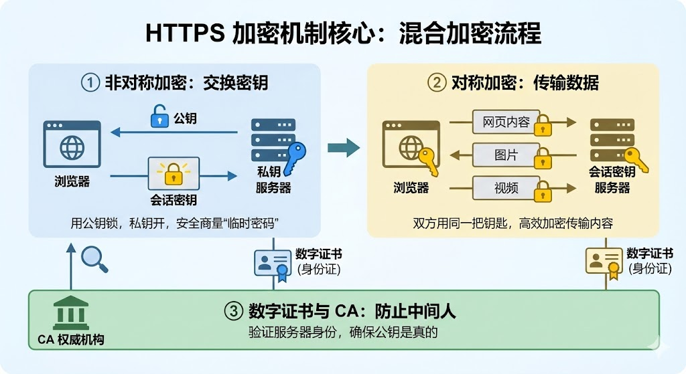

HTTPS 的加密机制，核心就四个字：**混合加密**。

它并不是只用一种算法，而是把“非对称加密”**（安全但慢）和**“对称加密”**（快但怕被偷）**结合起来，取长补短。

简单来说，整个流程就是：**先用“非对称加密”秘密地商量出一个“临时密码”，然后用这个“临时密码”通过“对称加密”来传输真正的数据。**

具体的原理逻辑分为三步走：

1. **非对称加密**
- **作用：** 用来**交换密钥**。
- **原理：** 有两把钥匙，一把叫**公钥**（大家都知道），一把叫**私钥**（只有服务器自己有）。
- **怎么用：** 浏览器用服务器给的“公钥”把数据锁上，发过去。因为只有服务器有“私钥”，所以只有服务器能打开。这保证了在建立连接时，咱们商量的秘密不会被中间人听去。
1. **对称加密**
- **作用：** 用来**传输实际内容**。
- **原理：** 只有一把钥匙（会话密钥），加密解密都用它。
- **怎么用：** 刚才第一步里，浏览器和服务器已经安全地商量好了一个“会话密钥”。接下来的网页内容、图片、视频，全都用这个密钥加密传输。
1. **数字证书与 CA**
- **作用：** 防止**中间人攻击**。
- **问题：** 如果黑客截胡了，假装自己是百度，给你发了个假的公钥怎么办？
- **解决：** 服务器必须找一个权威机构（CA）办一张身份证（数字证书）。浏览器访问时，先查这张证是不是真的（有没有被篡改、是不是权威机构发的）。只有证是真的，才敢用它的公钥。

### 面试标准回答

**总结**：HTTPS 就是用非对称加密解决了**密钥传递**的安全问题，用对称加密解决了**通信效率**的问题，同时用 CA 证书解决了**身份认证**的问题。

HTTPS 的安全性是由 SSL/TLS 协议保证的，它并不单一使用某一种算法，而是采用了一套**混合加密体系**。

它的核心原理可以分为三个层面：

第一，利用‘非对称加密’进行密钥交换：

在连接建立的握手阶段，使用非对称加密算法（如 RSA 或 ECC）。服务器将公钥发送给客户端，客户端利用公钥加密生成的随机数（Pre-master secret），发回给服务器。只有持有私钥的服务器才能解密。这样做是为了安全地协商出后续通信所需的密钥。

第二，利用‘对称加密’进行数据传输：

一旦握手完成，拿到共享密钥（Session Key）后，双方就切换到对称加密模式（如 AES）。因为对称加密的运算速度比非对称加密快几个数量级，适合传输大量的 HTTP 报文数据。

第三，利用‘数字证书’保证身份可信：

为了防止中间人攻击（Man-in-the-Middle），服务器必须提供由权威 CA 机构颁发的数字证书。客户端通过验证证书的签名和完整性，确保它正在通信的确实是目标服务器，而不是伪造者。
