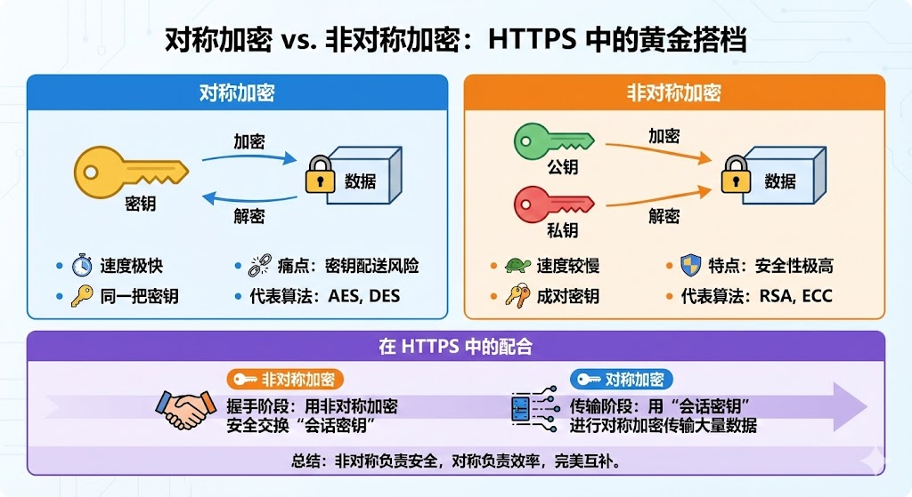

简单来说，这两者的区别就在于**钥匙有几把**，以及**解密的规则**不一样。

在 HTTPS 里，它们并不是竞争关系，而是**互补关系**。

我们可以这样理解：

1. **对称加密**
- **原理：** 加密和解密用的是**同一把密钥**。就像你家门的钥匙，锁门用它，开门也用它。
- **特点：** 算法简单，计算**速度极快**，适合处理大量数据。
- **痛点：** 最大的问题是“钥匙怎么送过去”。如果我在网上把钥匙发给你，被黑客截获了，那加密就白做了。
- **代表算法：** AES、DES。
1. **非****对称加密**
- **原理：** 钥匙是成对出现的，一把叫**公钥**（Public Key），一把叫**私钥**（Private Key）。
    - **规则：** 用公钥锁上的东西，**只有****私钥****能打开**（反之亦然）。
    - 就像我在门口放个带锁的信箱（公钥），谁都能往里投信并锁上，但只有我有唯一的钥匙（私钥）能打开看里面的信。
- **特点：** 安全性极高，不用担心密钥泄漏（因为公钥本来就是公开的）。
- **痛点：** 算法太复杂，**计算非常慢**（比对称加密慢几百上千倍）。
- **代表算法：** RSA、ECC。

在 HTTPS 中的配合：

因为“对称加密”快但怕偷，“非对称加密”安全但慢，所以 HTTPS 先用非对称加密把“钥匙”安全地送过去，然后再用对称加密疯狂传数据。

### 面试标准回答

对称加密和非对称加密是密码学中的两种核心机制，在 HTTPS 中它们分别承担不同的职责：

**第一，对称加密**：

- **定义**：指加密和解密使用**同一个密钥**。
- **特点**：计算量小、**速度快**、效率高。
- **应用**：在 HTTPS 连接建立后的**数据传输阶段**，我们使用对称加密来传输实际的业务数据（如 HTML、图片）。

**第二，非对称加密**：

- **定义**：拥有**一对密钥**（公钥和私钥）。公钥加密的数据，只能由私钥解密；私钥签名的数据，由公钥验证。
- **特点**：安全性高，解决了‘密钥传输’的难题，但**计算速度很慢**。
- **应用**：在 HTTPS 的**握手阶段**（Handshake），我们使用非对称加密来安全地协商和交换‘对称加密的密钥’。
