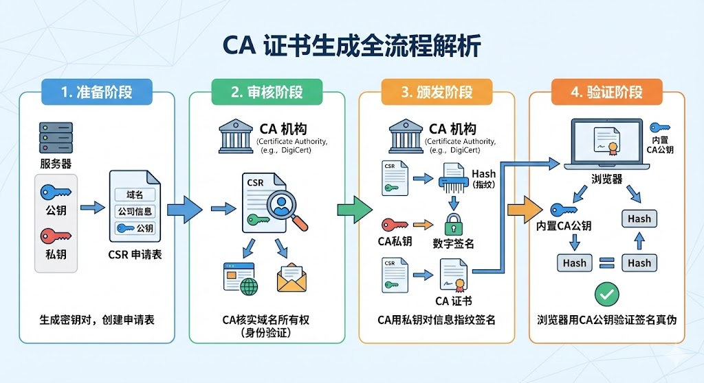

CA 证书是由一个大家都信任的第三方机构（CA 机构，比如 DigiCert、Let's Encrypt）发行的。它的核心作用只有两个：**证明你是你（身份验证）**，以及**告诉对方你的公钥是多少（密钥分发）**。

如果没有它，黑客可以在中间拦截你的请求，把自己伪装成淘宝或百度，给你发一个假的公钥，你根本分辨不出来。有了证书，浏览器就能查验：这张证是不是权威机构发的？有没有被涂改过？

它的生成过程如下：

1. 准备阶段

服务器管理员（网站持有者）先在自己服务器上生成一对密钥（公钥和私钥）。

然后，创建一个叫 CSR (Certificate Signing Request) 的文件。你可以把它理解为“申请表”，里面填了网站的域名、公司信息，并且把公钥也贴在里面。

1. 审核阶段

把 CSR 发给 CA 机构。CA 会去核实：你真的是这个域名的主人吗？（比如让你在网站放个特定文件，或者给域名邮箱发邮件）。

1. 颁发阶段

CA 审核通过后，会拿出它自己的私钥，对你的申请信息（包括你的公钥）进行数字签名。

- 具体做法是：先把你申请表里的信息算出一个指纹（Hash），然后用 CA 的私钥对这个指纹加密。
- 这个“加密后的指纹”加上“你的原始信息”，就是最终的 **CA 证书**。
1. 验证阶段

浏览器内置了各大 CA 机构的公钥。当你访问网站时，浏览器用 CA 的公钥去解开证书上的签名，如果解开了，并且算出来的指纹和信息一致，就说明这张“身份证”是真的。

### 面试标准回答

CA 证书是 HTTPS 安全体系中的信任锚点。它本质上是一个包含公钥、拥有者信息以及数字签名的文件。

**第一，关于它的定义：**

它是为了解决‘公钥归属’问题而诞生的。它通过可信第三方（CA）的数字签名，将公钥和域名主体进行绑定，防止中间人伪造公钥。

**第二，关于它的生成流程，通常分为三步**：

1. 服务端首先在本地生成公钥和私钥，然后将公钥和主体信息（如域名、组织）打包生成一个 CSR 文件。
2. 将 CSR 提交给 CA 机构，CA 验证申请者的身份（如域名所有权验证）。
3. CA 机构使用自己的私钥，对 CSR 中的信息摘要（Hash 值）进行加密，生成数字签名。这个签名和原始信息组合在一起，就构成了最终的证书。
