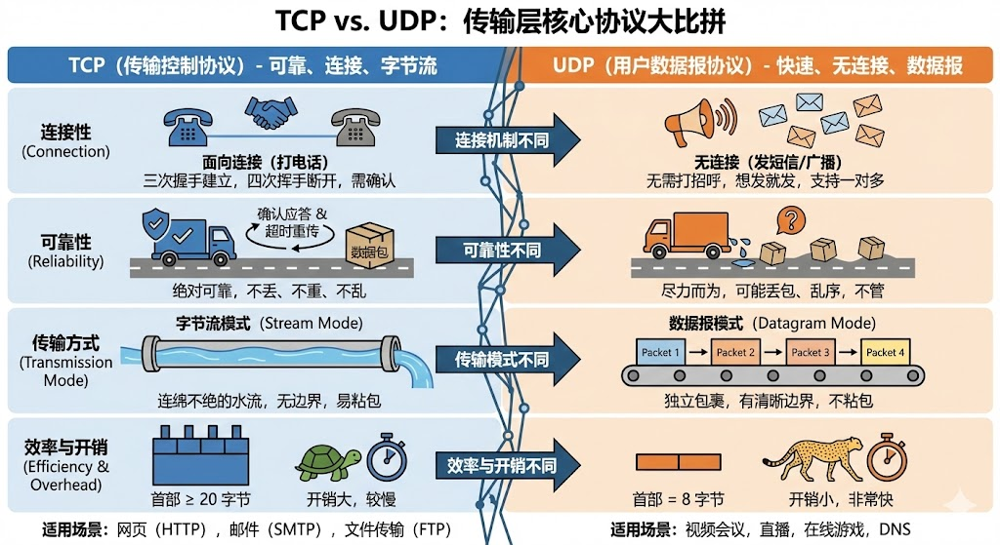

TCP 是面向连接的、保证数据可靠、面向字节流传输的协议；

UDP 是面向无连接的、不保证数据可靠、面向报文传输的协议；

具体的区别如下：

1. **连接性**
- **TCP** **是面向连接的**。发数据前必须先“打电话”确认对方在线（三次握手），发完了还得挂电话（四次挥手）。
- **UDP** **是无连接的**。就像发短信或者广播，想发就发，不需要提前打招呼。
1. **可靠性**
- **TCP** **绝对可靠**。它有确认机制（ACK）、超时重传、流量控制。保证数据**不丢、不重、不乱**。
- **UDP** **不可靠**。它只管“尽力而为”。网不好可能就丢包了，顺序乱了也不管。
1. **传输方式**
- **TCP** **是“流模式”**。它把数据看成连绵不绝的水流，没有边界。所以容易出现“粘包”问题，需要应用层自己去拆分。
- **UDP** **是“数据报模式”**。它发的是一个个独立的包裹，有清晰的边界。发一个就是一个，不会粘在一起。
1. **效率与开销**
- **TCP** **比较慢，开销大**。首部至少 20 字节，还要处理握手和重传逻辑，比较耗资源。
- **UDP 非常快，开销小**。首部只有 8 字节，不仅轻便，而且支持一对多广播。

---

### 面试标准回答

TCP 和 UDP 是传输层最核心的两个协议，它们的区别主要体现在四个方面：

第一，连接机制不同：

TCP 是面向连接的，传输数据前必须通过三次握手建立连接；

而 UDP 是无连接的，即发送数据之前不需要建立连接。

第二，可靠性不同：

TCP 提供可靠传输服务，通过确认应答、超时重传、流量控制和拥塞控制，保证数据无差错、不丢失、不重复且按序到达；

而 UDP 只是尽最大努力交付，不保证可靠性，网络拥堵时容易丢包。

第三，传输模式与开销不同：

TCP 是面向字节流的，首部开销较大（最小 20 字节）；

UDP 是面向报文的（保留报文边界），首部开销很小（只有 8 字节），且支持一对多广播。

第四，适用场景不同：

TCP 适合对准确性要求高的场景，如网页浏览（HTTP）、邮件（SMTP）、文件传输（FTP）；

UDP 适合对实时性要求高、能容忍少量丢包的场景，如视频会议、直播、DNS 解析、在线游戏。
