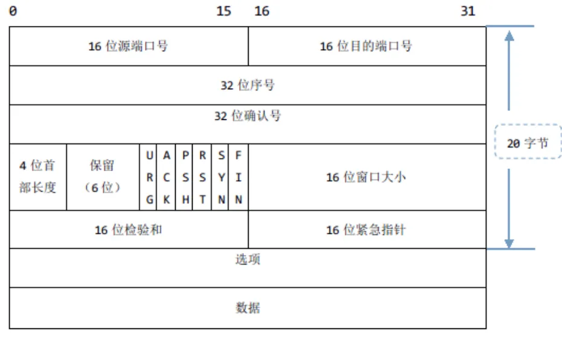

TCP 报文头，通常我们也叫它“首部”。它就像是**快递单**，贴在数据包裹的最外面。

如果不算那些可选的补充信息，标准的 TCP 报头长度是固定的 **20 字节**。这 20 个字节设计得非常紧凑，每一位都有大用处。

我们可以把里面的字段按**功能**分成四大块来理解：

1. **地址信息**
- 源端口（Source Port） 和 目的端口（Destination Port）：
- 这是报头最前面的部分。IP 地址只能送到电脑，而端口号负责告诉操作系统：“这数据是给微信的，还是给浏览器的？”
1. **可靠性核心**
- 序号（Sequence Number）：
- TCP 是面向字节流的，给每个字节都编了号。这个字段告诉对方：“我现在发的这个包，是整个数据流里的第几个字节开始的”。解决乱序问题全靠它。
- 确认号（Acknowledgment Number）：
- 发给对方看，意思是：“你之前发的第 X 号数据我都收到了，下次请从第 X+1 号开始发给我”。解决丢包问题全靠它。
1. **控制位**
- 这里有 6 个非常关键的比特位（Flags），标记报文目的。
    - **SYN**：发起连接（我要找你说话）。
    - **ACK**：回复确认（收到了）。
    - **FIN**：结束连接（我说完了，挂了）。
    - **RST**：重置连接（出错了，强制断开）。
    - **PSH**：推数据（别缓存了，赶紧交给应用层）。
    - **URG**：紧急指针（插队）。
1. **流量控制**
- 窗口大小（Window Size）：
- 告诉对方：“我家仓库（缓存）还剩多少空位，你悠着点发，别把我撑爆了”。这是 TCP 做流量控制的核心字段。
1. **校验与辅助**
- **数据偏移**：告诉系统报头有多长，数据从哪开始读。
- **校验和（Checksum）**：用来检查数据在路上有没有损坏。

### 面试标准回答

TCP 报文头标准长度为 **20 字节**（不含选项），其核心字段主要包含以下几类：

第一，端口号（寻址）：

包含源端口和目的端口，用于在主机上标识具体的应用程序（进程）。

**第二，序列号与确认号（可靠性）**：

- **序号（Sequence Number）**：用于对字节流进行编号，保证数据按序到达，去除重复数据。
- **确认号（Acknowledgment Number）**：期望收到对方下一个报文段的第一个字节的序号，是实现可靠传输的核心。

第三，控制位（状态管理）：

最重要的是 6 个标志位，特别是：

- **SYN**：用于建立连接。
- **FIN**：用于释放连接。
- **ACK**：表明确认号有效。
- **RST**：用于重置连接。

第四，窗口大小（流量控制）：

用于告知对方自己的接收缓冲区还能容纳多少字节，从而控制发送方的发送速率。

**此外**，还包含**数据偏移**（指出首部长度）、**校验和**（保证数据完整性）以及**紧急指针**等字段。
