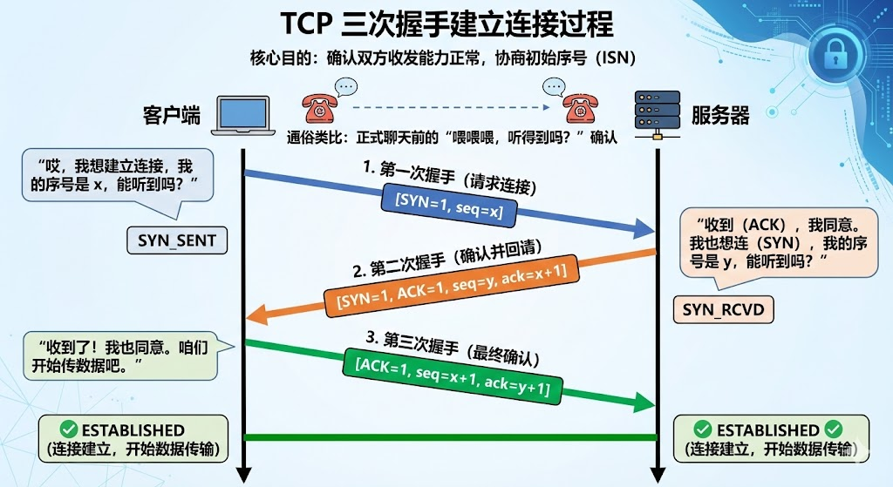

TCP 三次握手，通俗点说，就是**两个人在正式开始聊天前，先确认一下双方的电话线是不是通的**。

它的核心目的不仅仅是建立连接，更重要的是让通信双方**交换初始序号（ISN）**，确认彼此的“发送”和“接收”能力都是正常的。

整个过程由客户端（Client）发起，服务器（Server）响应，具体步骤如下：

**第一次握手：客户端请求连接（Client -> Server）**

- **动作**：客户端给服务器发一个报文。
- **内容**：标志位 **SYN=1**，随机产生一个序号 **seq=x**。
- **含义**：客户端说：“哎，我想跟你建立连接，我的初始序号是 x，你能听到吗？”
- **状态**：客户端进入 **SYN_SENT**（发送连接请求）状态。

**第二次握手：服务器确认并回请（Server -> Client）**

- **动作**：服务器收到请求后，必须给个回复，同时自己也要发个连接请求。
- **内容**：标志位 **SYN=1, ACK=1**。确认号 **ack=x+1**（表示收到 x 了，期待 x+1），同时自己也生成一个序号 **seq=y**。
- **含义**：服务器说：“我收到你的请求了（ACK），我同意连接。同时我也想跟你建立连接（SYN），我的初始序号是 y，你能听到吗？”
- **状态**：服务器进入 **SYN_RCVD**（收到请求）状态。

**第三次握手：客户端最终确认（Client -> Server）**

- **动作**：客户端收到服务器的回复后，还得再回一个包。
- **内容**：标志位 **ACK=1**。确认号 **ack=y+1**（表示收到 y 了），序号 **seq=x+1**。
- **含义**：客户端说：“收到了！我也同意你的连接请求。咱们开始传数据吧。”
- **状态**：双方都进入 **ESTABLISHED**（连接建立）状态，连接正式建成。

### 面试标准回答

三次握手的本质是双方协商初始序列号（ISN）的过程，同时确认了双方的接收能力和发送能力都是正常的，从而保证了连接的可靠性。

第一次握手：

客户端发送 SYN 报文（SYN=1, seq=x）给服务器，进入 SYN_SENT 状态。这是为了告诉服务器：我想建立连接，并告知我的初始序号。

第二次握手：

服务器收到 SYN 包后，回复一个 SYN+ACK 报文（SYN=1, ACK=1, seq=y, ack=x+1），进入 SYN_RCVD 状态。这是为了确认客户端的序号，同时告知客户端自己的初始序号。

第三次握手：

客户端收到服务器的 SYN+ACK 包后，发送一个 ACK 报文（ACK=1, seq=x+1, ack=y+1），最后双方进入 ESTABLISHED 状态。
