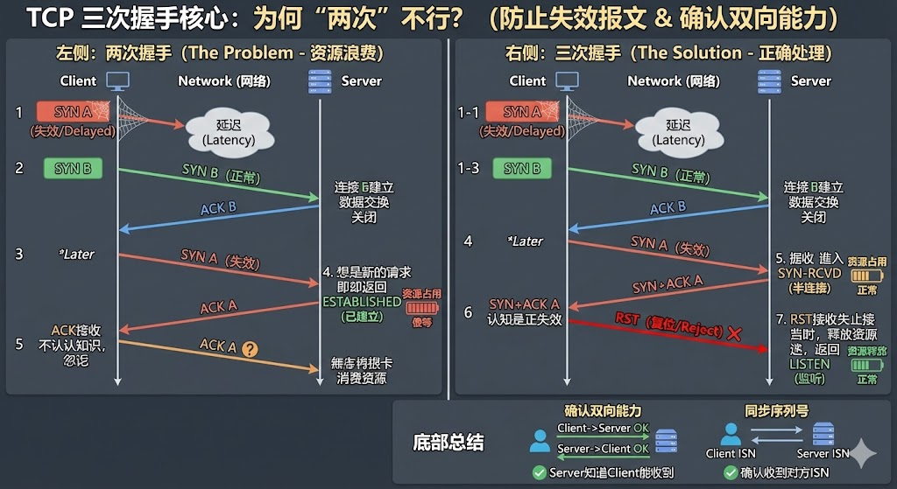

这个问题，核心就为了解决一个历史遗留问题：**防止“已失效的连接请求”突然又传到了服务端，导致服务端白白等待，浪费资源。**

简单来说，三次握手不是为了“建立连接”这个动作，而是为了“确认双方都在线，且网络没延迟”。如果只有两次，服务端很容易被网络里迷路的“僵尸包”给骗了。

具体的逻辑主要体现在这三个层面：

1. 核心原因：防止失效报文

试想一下这个场景：

- 你发了一个连接请求 A（第一次），结果因为网络卡，A 堵在半路了。
- 你等不及了，又发了一个请求 B，这次通了，数据传完，你也断开了。
- **如果是两次握手：**
    - 这时候，那个迷路的 A 终于到了。服务器一看：“哟，来活了”，立马回个 ACK，连接就建好了，开始傻傻地等着你发数据。
    - 但你压根没想连，收到服务器的确认后你会觉得莫名其妙（直接丢弃），也不理它。
    - 结果：服务器一直挂着这个死连接，内存就被白白占用了。
- **如果是三次握手：**
    - 服务器收到 A，回个 ACK。
    - 你收到了，发现是旧的（或者是你没请求过的），直接回一个 **RST**（复位信号），告诉服务器：“我不认识这个请求，赶紧关了”。服务器收到后就释放资源了。
1. 确认双向通信能力

TCP 是全双工的（双向都能说话）。

- **第一次（Client -> Server）：** 服务器知道了：你的发送好着呢，我的接收好着呢。
- **第二次（Server -> Client）：** 你知道了：我的发送、接收都好着呢；服务器的发送、接收也都好着呢。
- **第三次（Client -> Server）：****关键在这里。** 如果没有这一步，服务器**不知道自己的发送能力是不是好的**（它不知道你听没听到）。只有收到你的最后确认，它才敢放心：看来我的话你也听到了。
1. 同步序列号（ISN）

TCP 可靠传输全靠序号（SEQ）。

- 两次握手只能保证你把你的初始序号告诉了服务器。
- 但服务器把它的初始序号告诉你之后，它无法确认**你是否真的收到了**。如果这个包丢了，后面服务器发的数据你都解不开。只有第三次握手，把你收到的序号回传回去，这事才算完了。

### 面试标准回答

三次握手本质上是在不可靠的信道上，通过最小的通信次数，建立起可靠的双向关联。

TCP 坚持使用三次握手而不是两次，主要有两个核心原因：

第一，为了防止‘已失效的连接请求’突然到达服务端，导致资源浪费（这是谢希仁版教材的核心观点）。

假如采用两次握手，如果客户端发出的第一个 SYN 包在网络中滞留了，等客户端关闭连接后该包才到达服务端。此时服务端会误认为这是一个新的连接请求，于是立即建立连接并等待数据。但客户端并不会理会这个确认，这就导致服务端一直挂起，浪费 CPU 和内存资源。三次握手可以在这种情况下，通过客户端发送 RST 报文来拒绝连接。

第二，为了实现双方初始序列号（ISN）的可靠同步。

TCP 协议是双向的，双方都需要维护自己的序列号。

- 第二次握手只是同步了‘客户端’的 ISN。
- 只有通过第三次握手，客户端回复确认，服务端才能确定客户端收到了自己的 ISN。
- 如果只有两次，服务端无法确认自己的 ISN 是否被对方接收，可靠传输就无从谈起。
