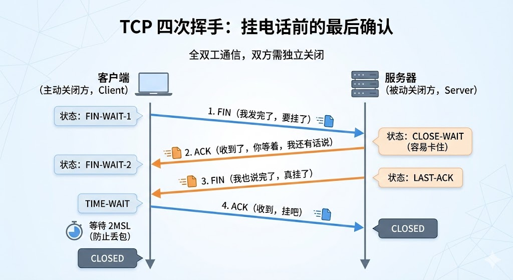

TCP 四次挥手，其实就是**两个人在挂电话前的最后确认**。

因为 TCP 是**全双工**的，也就是说数据可以同时双向传输。所以，“我不再给你发数据了”**和**“你不再给我发数据了”是两件独立的事情，必须分开来处理。这就导致断开连接比建立连接要麻烦，需要四步。

整个过程通常由客户端主动发起（假设是客户端先关闭），具体步骤如下：

**第一次挥手：客户端提出分手（Client -> Server）**

- **动作**：客户端发送一个报文，**FIN=1**，序号 **seq=u**。
- **含义**：客户端说：“我的数据发完了，我不跟你说话了，请求关闭连接。”
- **状态**：客户端进入 **FIN-WAIT-1** 状态。此时客户端**只收不发**（不再发业务数据，但还能发 ACK）。

**第二次挥手：服务器同意（Server -> Client）**

- **动作**：服务器收到后，先回一个 **ACK**，确认号 **ack=u+1**，序号 **seq=v**。
- **含义**：服务器说：“好的，我知道你想挂电话了。但我这边可能还有话没说完，你先等着，把耳朵竖起来听。”
- **状态**：
    - 服务器进入 **CLOSE-WAIT**（关闭等待）状态。这是最容易卡住的状态。
    - 客户端收到后，进入 **FIN-WAIT-2** 状态。

**第三次挥手：服务器也提出分手（Server -> Client）**

- **动作**：服务器把剩下的数据发完后，也发一个报文，**FIN=1, ACK=1**，序号 **seq=w**。
- **含义**：服务器说：“好了，我也没话说了，现在正式关闭咱们的连接。”
- **状态**：服务器进入 **LAST-ACK**（最后确认）状态。

**第四次挥手：客户端最终确认（Client -> Server）**

- **动作**：客户端收到后，回一个 **ACK**，确认号 **ack=w+1**，序号 **seq=u+1**。
- **含义**：客户端说：“收到，那就挂了吧。”
- **状态**：
    - 服务器收到这个 ACK 后，彻底 **CLOSED**。
    - **注意**：客户端此时并不会立即关闭，而是进入 **TIME-WAIT** 状态，等待 **2MSL**（最长报文段寿命）的时间后，才真正 **CLOSED**。这是为了防止最后一个 ACK 丢了，服务器没收到。

### 面试标准回答

TCP 四次挥手是断开连接的过程，由于 TCP 是全双工通信，双方必须单独关闭自己的发送通道，因此需要四步：

第一步（FIN）：

主动关闭方（如客户端）发送 FIN 报文，表示‘我没有数据要发了’，进入 FIN-WAIT-1 状态。

第二步（ACK）：

被动关闭方（如服务器）收到 FIN 后，回复一个 ACK。此时，服务器进入 CLOSE-WAIT 状态，表示‘我知道你要关了，但我可能还有数据没传完’。客户端收到后进入 FIN-WAIT-2。

第三步（FIN）：

服务器将剩余数据发送完毕后，向客户端发送 FIN 报文，表示‘我也没数据了’，进入 LAST-ACK 状态。

第四步（ACK）：

客户端收到服务器的 FIN 后，回复 ACK，并进入 TIME-WAIT 状态。服务器收到 ACK 后直接 CLOSED。客户端等待 2MSL 时间后也进入 CLOSED。
