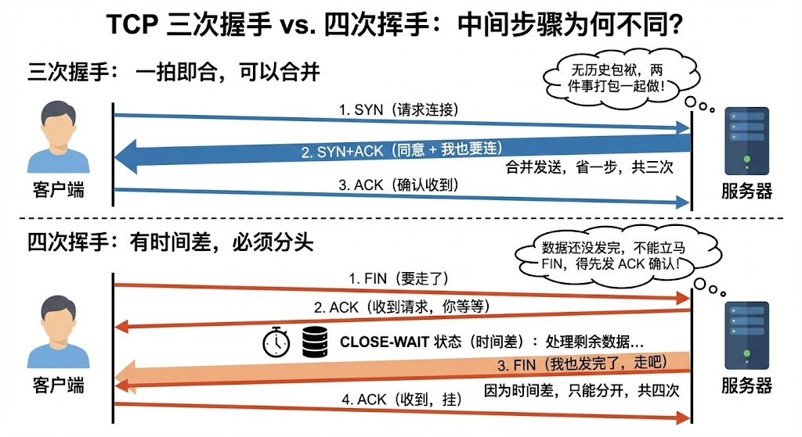

这个问题最核心的原因就在于 TCP 是**全双工**通信的。

简单来说：**握手的时候，双方是一拍即合的，所以可以合并；挥手的时候，因为还有数据没发送完，所以必须分头行动。**

具体拆解来看，区别在于“中间那两步能不能合并”：

1. 三次握手为什么能合并？

当服务器收到客户端的连接请求（SYN）时，服务器这边没有任何历史包袱，它既要确认对方（ACK），又要发起自己的连接（SYN）。这两件事可以同时做，打包成一个 SYN+ACK 报文发过去。省了一步，所以是三次。

1. 四次挥手为什么不能合并？

当服务器收到客户端的断开请求（FIN）时，情况就不一样了：

- **第一步（ACK）：** 必须立马回复：“我知道你想走了”。这是为了告诉客户端，你的请求我收到了，别重传了。
- **尴尬的时间差：** 此时，服务器的应用层可能**还有一堆数据堆在缓存里没发完**。它不能立马发 FIN（结束），它得先把剩下的数据发完。
- **第二步（FIN）：** 等所有数据都发完了，服务器才能单独发一个 FIN：“好了，我也没话说了，挂吧”。

**总结：** 正因为“确认收到关闭请求”**和**“自己真正准备好关闭”之间有一个时间差（也就是 **CLOSE-WAIT** 状态），导致 ACK 和 FIN 必须分两次发，于是就变成了四次。

### 面试标准回答

TCP 断开连接之所以需要四次挥手，而不是像建立连接那样三次，根本原因在于 TCP 是全双工（Full Duplex）的协议。

**具体的区别在于服务端响应的时机**：

1. **在建立连接时**：服务器收到 SYN 后，可以直接将 **ACK**（确认）和 **SYN**（发起）合并在同一个报文（SYN+ACK）中发送，因为此时没有历史数据需要处理。
2. **在断开连接时**：
    1. 当服务器收到客户端的 **FIN** 报文时，协议要求必须立即回复一个 **ACK**，告知客户端‘收到关闭请求’。
    2. 但在此时，服务器端可能还有**剩余的数据未发送完毕**。它需要先进入 **CLOSE-WAIT** 状态，将遗留数据处理完之后，才能单独发送自己的 **FIN** 报文来请求关闭连接。
