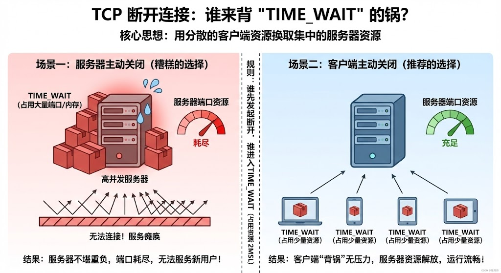

这个问题归根结底就是一个“成本分配”的问题。

在 TCP 协议里有一个很“霸道”的规则：**谁先发起断开连接（Active Close），谁就会进入 TIME_WAIT 状态，并不得不保留资源一段时间（2MSL）。**

为了保护服务器的公共资源，我们通常希望把这个“锅”甩给客户端去背。

具体原因可以从以下三点来拆解：

1. **避免服务器的端口耗尽**
- **服务器的苦衷：** 一台服务器要同时服务成千上万个用户。如果服务器主动断开连接，那么成千上万个连接就会在服务器端进入 `TIME_WAIT` 状态。
- **后果：** 每个 `TIME_WAIT` 连接都会占用一个本地端口。服务器的端口范围是有限的（通常是 65535 以内）。一旦端口被这些“等待中”的连接占满了，新的用户就挤不进来了，服务直接瘫痪。
1. **节省服务器的内存资源**
- 虽然一个 TCP 连接占用的内存不算多，但在高并发场景下，维持几万个 `TIME_WAIT` 状态的控制块（TCB）也是一笔不小的开销。服务器的资源应该用来处理真正的计算和 I/O，而不是花在干等上。
1. **客户端“背锅”无压力**
- **客户端的优势：** 对于个人的电脑或手机来说，同时建立的连接通常也就几个或几十个。哪怕这几十个连接全变成了 `TIME_WAIT`，占用了几十个端口，对你来说也九牛一毛，根本感觉不到。
- 所以，从全局资源优化的角度看，让客户端主动断开是性价比最高的选择。

---

### 面试标准回答（建议背诵）

这是典型的‘用分散的客户端资源来换取集中的服务器资源’的设计思想。

主要目的是**为了保护服务器资源，避免端口耗尽**。

核心原因在于 TCP 的状态流转机制：**主动发起关闭的一方，在四次挥手结束后会进入** `**TIME_WAIT**` **状态，并持续 2MSL 的时间（通常几分钟）。**

如果是服务器主动关闭：

在高并发场景下，服务器端会积累大量处于 TIME_WAIT 状态的连接。这不仅会占用内存（TCB），更致命的是会占用本地端口。一旦可用端口耗尽，服务器将无法响应新的连接请求，导致服务不可用。

如果是客户端主动关闭：

TIME_WAIT 状态会产生在客户端。由于客户端通常只有少量连接，占用几个端口对其几乎没有影响。
