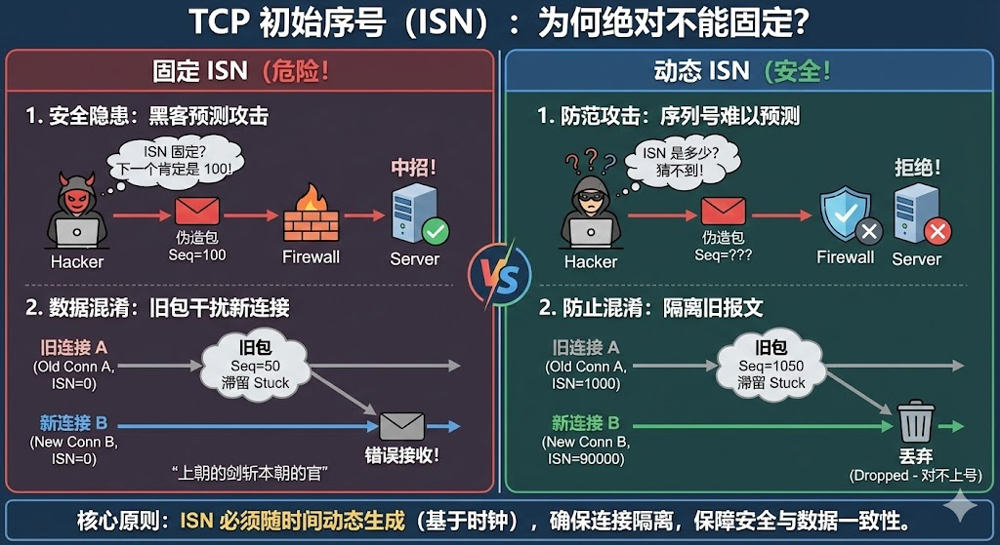

**绝对不能固定**。

如果 ISN 是固定的（比如每次连都从 0 开始），哪怕是按简单规律递增，都会给网络安全和数据传输带来毁灭性的灾难。ISN 必须是**随时间动态生成**的（通常和时钟有关）。

为什么不能固定？主要有两个核心原因：一个是**防黑客**，一个是**防“穿越”**。

1. 安全隐患

这是最要命的。如果 ISN 固定，黑客根本不需要看你们传输的内容，只要知道你们建立连接的规律，就能在千里之外伪造一个数据包发给服务器。

- **攻击场景：** 黑客假装自己是受信任的客户端，给服务器发请求。虽然他收不到服务器的回包，但他知道 ISN 是固定的，就能猜出服务器期望的下一个确认号是多少。于是他盲发一个带有正确确认号的恶意指令，服务器一校验：“哎，号对上了，是自己人”，然后就被攻破了。这就是著名的**TCP 序列号预测攻击**。
1. 数据混淆

网络是很拥堵的，有时候一个数据包在路上迷路了（滞留），等了几分钟才到。

- **场景：**
    - 你建立了连接 A，发了个包（序号 100），结果卡路上了。
    - 你断开了连接 A，立刻又建立了一个完全一样的新连接 B（源IP、端口、目标IP、端口都一样）。
    - 如果 ISN 是固定的，连接 B 的序号也是从头开始。
    - 这时候，那个迷路的旧包（序号 100）终于到了。
    - 新连接 B 一看：“哟，序号 100，正好是我现在要的”，于是把上朝的剑斩了本朝的官，数据彻底乱套。
- **解决：** 如果 ISN 是随机变化的，新连接 B 的初始序号可能是 10000，那个旧包（序号 100）来了因为对不上号，直接就被扔掉了。

### 面试标准回答

ISN 的生成通常是基于时钟的一个算法（RFC1948 中建议 ISN = M + F(...)），确保每个新连接的初始号都不同，从而从物理和逻辑上隔离新旧连接。

TCP 连接的 ISN（初始序列号）是绝对不能固定的，它必须随时间动态生成。主要基于两个核心原因：

第一，为了安全性，防止 TCP 序列号预测攻击。

如果 ISN 是固定或可预测的，攻击者可以在不截获流量的情况下，伪造合法的 TCP 报文（IP Spoofing）。攻击者只需要构造一个这就对得上的序列号，就能通过服务器的验证，从而向连接中注入恶意数据或复位连接。

第二，为了数据的一致性，防止历史报文被错误接收。

在高速网络中，如果同一个 TCP 连接（五元组相同）被快速复用，而 ISN 又是固定的。那么上一次连接中在网络滞留的‘旧报文’，极有可能正好落在新连接的接收窗口内，导致数据错乱。
