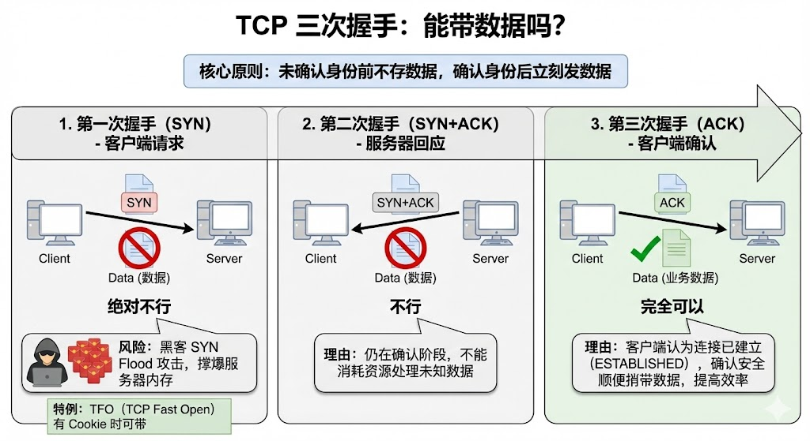

**第三次握手可以，前两次（通常）不可以。**

只要记住一个核心原则：**“未确认身份前不存数据，确认身份后立刻发数据”**。

具体的情况拆解如下：

1. **第一次握手（SYN）：绝对不行**
- **为什么不行？** 如果允许第一次握手就带数据，那黑客就开心死了。
- **攻击场景：** 黑客可以疯狂发送带有一大堆垃圾数据的 SYN 包（第一次握手）。服务器收到后，不仅要分配内存记录这个连接，还得开辟缓冲区存这些数据。服务器内存瞬间就被撑爆了。这就是加强版的 **SYN Flood 攻击**。
- **特例：** Google 提出的 **TFO (TCP Fast Open)** 协议允许第一次握手带数据，但前提是你俩之前认识（有 Cookie），否则一律免谈。
1. **第二次握手（SYN+ACK）：不行**
- 理由同上，服务器还在确认阶段，不能消耗资源去处理未知的数据。
1. **第三次握手（ACK）：完全可以**
- **为什么可以？** 此时对于客户端来说，连接已经是 **ESTABLISHED**（已建立）状态了。客户端已经确认了服务器是活的，也有能力收发。所以，客户端在发最后一个 ACK 的同时，顺便把第一波业务数据捎带过去，是完全符合协议规范（RFC 793）的，也能提高效率。

### 面试标准回答

TCP 标准协议对三次握手携带数据是有严格限制的，我们可以分阶段来看：

第一，对于前两次握手（SYN 阶段），通常是不允许携带数据的。

这主要是基于安全性考虑。如果允许 SYN 包携带数据，服务器在收到请求且未验证客户端身份前，就必须分配内存缓存这些数据。攻击者可以利用这一点，通过发送大量携带大负载的 SYN 包，耗尽服务器内存，加剧 SYN Flood 攻击的破坏力。

第二，对于第三次握手（ACK 阶段），是可以携带数据的。

因为在发送第三次握手报文时，客户端已经进入了 ESTABLISHED 状态，它已经确认了服务器的接收能力正常。此时携带数据不会带来额外的安全风险，反而能提升数据传输效率。

**（进阶补充）**：不过，随着技术发展，现在的 **TCP Fast Open (TFO)** 机制允许在第一次握手中携带数据，但前提是客户端必须持有服务器之前颁发的有效 **Cookie** 来证明身份，从而绕过安全风险。
