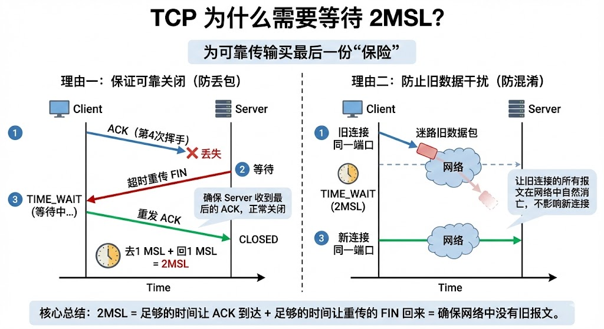

这个问题，本质上是为了给 TCP 的可靠传输**买最后一份“保险”**。

简单来说，客户端在发完最后一句“再见”后，不能立马挂电话，它得守着电话机再等一会儿。为的是防止对方没听见，同时也为了让网络里那些迷路的旧数据统统死光。

这里的 2MSL（Maximum Segment Lifetime，报文最大生存时间）具体是为了解决两个核心问题：

1. **可靠关闭**
- **场景：** 客户端发了最后一个 ACK（第四次挥手），告诉服务器“我走了”。但万一这个 ACK 在路上**丢了**呢？
- **后果：** 服务器那边一直在等 ACK，等不到就会以为刚才发的 FIN（第三次挥手）客户端没收到，于是服务器会**重发**一遍 FIN。
- **为什么要等：** 如果客户端发完 ACK 直接关机（CLOSED），那服务器重发的 FIN 就没人理了，服务器会一直报错。所以客户端必须多等一会儿（TIME_WAIT），万一收到了服务器重发的 FIN，它还得负责再重发一次 ACK，确保服务器能正常关闭。
- **为什么是 2MSL：** 去一个 ACK 最多 1MSL，回来一个重发的 FIN 最多 1MSL。如果 2MSL 时间内没收到重发，说明对方肯定收到了。
1. **数据隔离**
- **场景：** 假设你刚断开连接，立马在同一个 IP 和端口上建立了一个新的连接。
- **后果：** 此时，上一个连接里有个迷路的数据包（比如卡在路由器里了）突然到了。新连接一看：“哎，端口一样，收下吧”。这一收，数据就全乱套了。
- **为什么要等：** 2MSL 的时间足够长，足以保证本次连接产生的所有数据包都在网络中**自然消亡**。这样，下一个连接开始时，网络里全是干净的。

### 面试标准回答

客户端在发送完最后一个 ACK 后，必须进入 TIME_WAIT 状态并等待 2MSL，主要有两个原因：

第一，为了保证连接的可靠关闭（防丢包）。

第四次挥手的 ACK 报文是有可能丢失的。如果丢失，处于 LAST-ACK 状态的服务端会触发超时重传，再次发送 FIN 报文。

如果客户端直接 CLOSED，就会响应 RST 导致服务端报错。设置 2MSL，是为了让客户端有时间收到重传的 FIN，并重新发送 ACK，确保服务端能正常进入 CLOSED 状态。

（2MSL = 1个 ACK 报文在网络中的最大生存时间 + 1个 重传 FIN 报文在网络中的最大生存时间）。

第二，为了防止旧连接的报文干扰新连接（防混淆）。

网络中可能存在滞留的旧报文。等待 2MSL 可以保证本连接产生的所有报文都在网络中彻底消失。

这样可以避免在同一端口建立新连接时，旧连接的失效报文突然到达，导致数据错乱。
