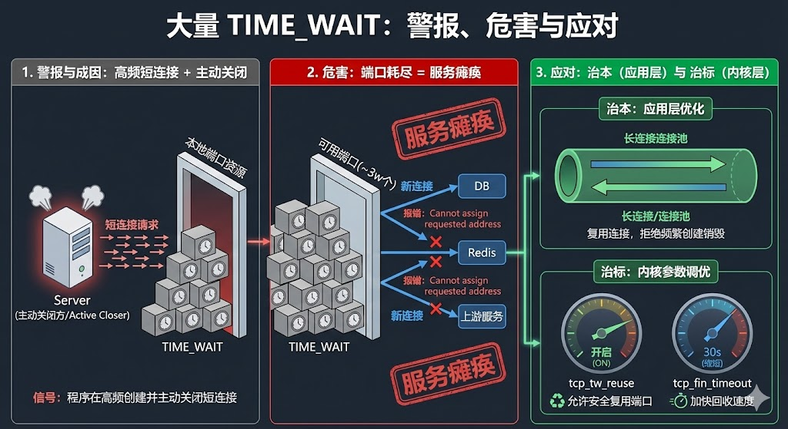

出现大量的 `TIME_WAIT`，通常就是系统在向你发出一个信号：**“你的程序正在高频地创建短连接，并且是你这一方在主动断开连接。”**

简单来说，`TIME_WAIT` 不可怕，它本来是保护连接的。但如果堆积了几万个，那就成了“占着茅坑不拉屎”，会导致你没法建立新连接。

### 为什么会出现？

核心原则只有一条：**谁主动关闭连接，谁就会进入 TIME_WAIT。**

比如**HTTP 客户端没用****连接池****：** 你的后端代码去调第三方接口（或者微服务之间调用），每次都 `new HttpClient()`，用完就关。这会让你的服务器作为“客户端”堆积大量 `TIME_WAIT`。

### 有什么危害？

- **端口****耗尽（最致命）：** TCP 连接是需要占用本地端口的（通常可用范围是 32768-61000，也就不到 3 万个）。
    - 如果堆积了 3 万个 `TIME_WAIT`，意味着你所有的端口都被占住了。
    - **后果：** 你的服务器想去连数据库、连 Redis、或者连上游服务，会直接报错 `Cannot assign requested address`（无法分配地址），整个服务瘫痪。
- **资源占用：** 虽然每个连接占用的内存很少，但积少成多也会消耗 CPU 和文件描述符。

### 如何应对？

解决思路分两步：**先改代码（治本），再调参数（治标）。**

- **应用层优化（治本）：**
    - **开启长连接（Keep-Alive）：** 把短连接变成长连接。让 Nginx、Tomcat 或你的 HTTP 客户端复用连接，不要每次都关。这是最有效的办法。
    - **使用连接池：** 数据库、Redis、HTTP 调用都要上连接池，严禁频繁创建销毁。
- **内核参数调优（治标）：**
    - **开启重用（**`**tcp_tw_reuse**`**）：****这是最推荐的配置。** 允许将处于 `TIME_WAIT` 状态的 socket 用于新的 TCP 连接。
    - **缩短等待时间（**`**tcp_fin_timeout**`**）：** 默认是 60 秒，可以改小一点（比如 30 秒），让它死得快一点。

---

### 面试标准回答

出现大量 `TIME_WAIT` 状态，通常是因为**当前主机正在进行高并发的短连接通信，并且是主动关闭连接的一方**。

这种情况在 HTTP 没有开启 Keep-Alive，或者微服务内部调用没有使用连接池时最为常见。

主要的危害是端口耗尽。

虽然 TIME_WAIT 占用的内存不多，但它会占用临时的随机端口（Ephemeral Ports）。一旦 65535 个端口范围内的可用端口被耗尽，新的连接（尤其是向外发起的连接）就会因为无法分配端口而失败。

**应对方案我一般会从两个层面入手：**

第一，应用层面：

尽量将短连接改为长连接。比如在 Nginx 或应用服务器中开启 Keep-Alive，在代码中引入 HTTP 连接池，减少连接的建立和断开频率。

第二，系统内核层面：

我会调整 /etc/sysctl.conf 中的参数。

- 最核心的是开启 `**net.ipv4.tcp_tw_reuse = 1**`。这允许操作系统在安全的前提下，复用处于 `TIME_WAIT` 的端口用于新建连接。
- 其次可以适当调小 `**tcp_fin_timeout**`（如调整到 30s），加快回收速度。
