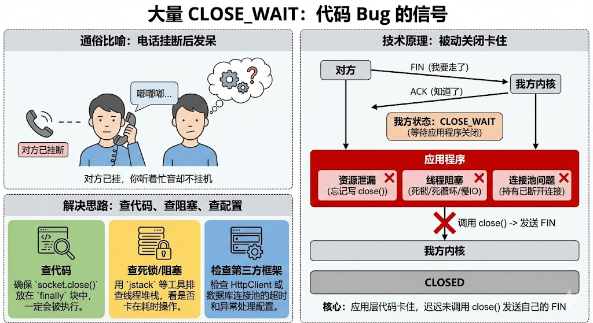

出现大量 `CLOSE_WAIT` 只有一种可能：**你的代码写得有 Bug**。

这和 `TIME_WAIT` 完全不同。`TIME_WAIT` 是主动关闭连接后的正常现象，可以通过调参优化；而 `CLOSE_WAIT` 是**被动关闭**的一方，收到了对方的FIN，回了ACK，然后就**死机了**，迟迟没有发出自己的FIN。

这就好比：**对方电话已经挂了，你听到了“嘟嘟”声，但你就是不挂电话，一直拿着听筒发呆。**

具体的分析逻辑如下：

1. **核心原理：被动关闭卡住了**
- **流程回顾：** 对方发来 `FIN` -> 我方操作系统内核自动回复 `ACK` -> 我方进入 `CLOSE_WAIT` 状态。
- **下一步本该是：** 我方应用程序检测到对方断连（read 返回 -1），执行 `close()` 方法，发送我方的 `FIN`。
- **问题点：** 你的程序**始终没有调用** `**close()**`，或者卡在了调用 `close()` 之前的某一步逻辑里。
1. **常见原因**
- **资源泄漏（最常见）：**
    - 代码里打开了 Socket 或数据库连接，用完了却没有关闭。比如没有把 `close()` 写在 `finally` 块里，或者中间抛出异常导致 `close()` 被跳过。
- **线程阻塞：**
    - 主线程在处理复杂的业务逻辑（比如死循环、死锁、或者是查数据库卡死了），导致它根本腾不出手来去执行关闭连接的操作。
- **连接池配置不当：**
    - 连接池里的连接已经被对方（比如数据库服务端）断开了，但客户端的连接池不知道，一直拿着这个半死不活的连接不释放。
1. **解决思路**
- **查代码：**
    - 检查所有涉及网络连接的地方，确保 `**socket.close()**` 一定会被执行（必须放在 `finally` 代码块中）。
- **查死锁/阻塞：**
    - 用 `jstack` 等工具打出线程堆栈，看看是不是有线程卡在某些 I/O 操作或锁等待上，导致无法走到关闭连接的那一行。
- **检查第三方框架：**
    - 如果是用 HttpClient 或数据库连接池，检查配置的超时时间是否合理，以及是否正确处理了异常释放逻辑。

### 面试标准回答

出现大量 `CLOSE_WAIT`，说明是**被动关闭连接的一方出了问题**。这通常意味着**应用层的代码有 Bug**，没有正确地释放资源。

在 TCP 四次挥手中，当对方发起关闭（发送 FIN）后，我方内核会回复 ACK 并进入 CLOSE_WAIT 状态。此时，内核正在等待应用程序调用 close() 方法来发送我方的 FIN 报文。

如果出现大量 CLOSE_WAIT，说明应用程序在接收到对方的关闭通知后，迟迟没有调用 close() 关闭连接。

**常见场景包括**：

1. **代码逻辑缺陷**：比如忘记关闭 Socket，或者在异常处理中跳过了关闭逻辑（未将 `close()` 放在 `finally` 块中）。
2. **线程阻塞**：处理请求的线程被业务逻辑死锁或长时间占用，导致无法执行到关闭连接的代码。
