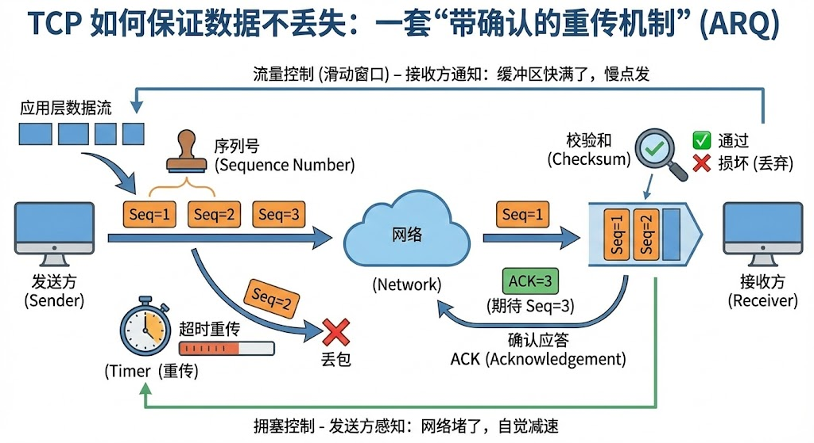

TCP 保证数据不丢失，核心就靠一套“带确认的重传机制”（ARQ）。

简单来说，TCP 是个“强迫症”：发出去的每一个字节，它都要给个编号，对方必须回复“收到了”，如果没收到回复，它就死磕到底，一直发到你收到为止。

为了把这个机制跑通，它设计了这么几道防线：

1. 序列号 Sequence Number

TCP 把应用层给它的数据看成连绵不断的泉水（字节流），然后给每一个字节都打上一个编号。

- **作用：** 解决**乱序**和**重复**问题。接收方收到数据后，看编号就知道这块数据该插在哪儿。如果编号重复了，直接丢掉。
1. 确认应答 ACK

接收方收到数据后，必须回一个 ACK 包，告诉发送方：“编号 X 之前的数据我都收齐了，下次请从 X+1 开始发”。

- **作用：** 这是发送方判断对方有没有收到的唯一依据。
1. 超时重传

发送方发完数据就开始掐表计时（RTO）。如果在规定时间内没收到 ACK，它就默认数据在路上丢了，或者 ACK 丢了。

- **动作：** 既然没收到确认，那就**重新发**一遍，直到收到确认为止。
1. 流量控制 & 拥塞控制

这俩虽然是控制速度的，但本质上也是为了防丢包。

- **流量控制（滑动窗口）：** 接收方告诉发送方：“我缓冲区快满了，你慢点发”。防止把接收方撑死导致丢包。
- **拥塞控制：** 发送方发现网络很堵（没收到 ACK），就会自觉减速。防止把网络堵死导致大规模丢包。
1. 校验和 Checksum

数据包里有个校验码。接收方收到后算一下，如果算出来的结果跟校验码对不上，说明数据在路上坏了（被电磁干扰改了比特位）。

- **动作：** 直接丢弃，不回 ACK，等着发送方超时重传。

### 面试标准回答

TCP 提供可靠传输，保证数据不丢失、不重复、按序到达，主要是通过以下几套机制协同工作的：

第一，核心机制是序列号（Sequence Number）和确认应答（ACK）。

TCP 给每个字节进行编号，接收方收到数据后必须回复 ACK。这解决了数据乱序和重复的问题，确认了数据确实到达了对端。

第二，保障机制是超时重传（Retransmission）。

如果发送方在规定时间（RTO）内没有收到 ACK，或者收到了连续的重复 ACK（触发快速重传），就会判定数据丢失并重新发送。这是解决丢包的根本手段。

**第三，预防机制是流量控制和拥塞控制。**

- **流量控制**利用滑动窗口机制，根据接收方的处理能力控制发送速度，防止接收端缓冲区溢出导致丢包。
- **拥塞控制**（慢启动、拥塞避免等）则是根据网络状况调整发送策略，防止网络过载导致丢包。

**最后**，TCP 还有校验和（Checksum）机制，用于检测数据在传输过程中是否出现比特翻转等错误，如果校验失败，数据会被丢弃并触发重传。”
