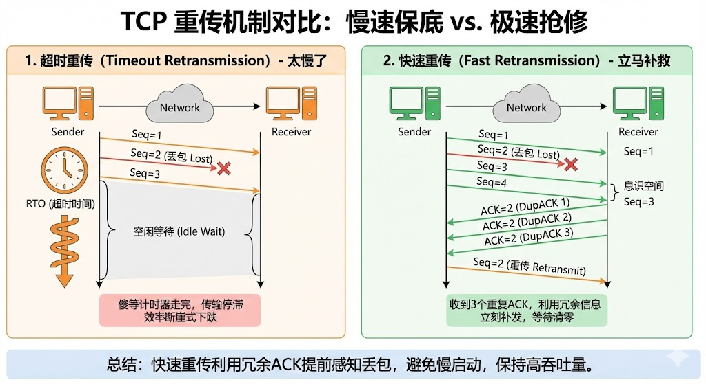

**超时重传是“保底”的，但它太慢了；快速重传是“抢修”的，它能不用傻等就立马补救。**

如果没有快速重传，TCP 的传输效率在丢包时会断崖式下跌。我们可以从这两个角度来理解：

1. **超时重传实在太慢了**
- **机制痛点：** 为了不误判，TCP 设定的超时时间（RTO）通常比往返时间（RTT）要长不少。
- **后果：** 一旦有个包丢了，发送方就得停下来，傻傻地等那个计时器走完（可能几百毫秒甚至更久），这期间它不敢发新数据，接收方也收不到数据。这对于看视频、打游戏这种实时性要求高的场景是致命的。
1. **快速重传利用了“冗余信息”**
- **机制优势：** 接收方虽然没收到中间那个包，但收到了后面的包。它会连续发送 3 个重复的 ACK（DupACK）提醒发送方。
- **逻辑：** 发送方一收到 3 个重复催单，就立刻明白：“哦，虽然有个包丢了，但网络没断，后续的包对方都收到了”。
- **动作：** 既然网络还能跑，那就别等计时器了，**立刻**把那个丢的包补发过去。这直接把等待时间清零了。

---

### 面试标准回答

TCP 引入快速重传机制，主要是为了解决**超时重传机制效率低下**的问题。

第一，解决‘空闲等待’的问题：

超时重传（RTO）的时间设置通常略大于 RTT（往返时延）。这意味着一旦丢包，发送方必须等待一段较长的时间才能感知并重传。在这段等待期内，传输处于停滞状态，严重降低了吞吐量。

第二，利用‘冗余 ACK’提前感知丢包：

当接收方发现接收序列中有‘空洞’（即中间某个包丢了，但后面的包到了），它会立即发送重复的 ACK（DupACK）。

快速重传机制规定：一旦发送方连续收到 3 个重复的 ACK，就认为该报文段已丢失，而无需等待超时定时器过期，立即重传丢失的报文。

第三，拥塞控制策略不同：

触发超时重传通常意味着网络严重拥堵，TCP 会极大地削减发送窗口（进入慢启动）；而触发快速重传说明网络并未完全瘫痪（后续包还能到达），因此 TCP 采取的拥塞控制措施相对温和（快速恢复），能更好地保持传输速率。
