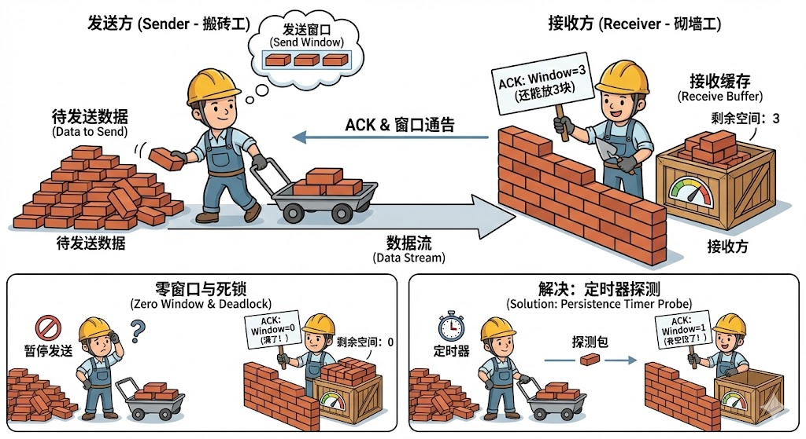

流量控制，说白了就是“根据接收能力来决定发送速度”。

这就像是**两个人配合干活**：你是搬砖的（发送方），我是砌墙的（接收方）。我砌墙需要时间，旁边能堆砖的地方（缓存）也有限。如果你搬得太快，砖头堆不下就会掉沟里（丢包），那就白干了。

所以，我得实时告诉你：“哥们，我这儿还能放 3 块砖”，你就只搬 3 块。等我砌完了，再喊你继续搬。这就是流量控制。

它的具体工作流程基于“滑动窗口”机制：

1. 告知窗口（我还能吃多少）

TCP 报文头里有一个字段叫 Window（窗口大小）。接收方每次回 ACK 的时候，都会把这个数字填进去，意思是：“我现在的缓冲区还剩这么大空位，你看着办”。

1. 动态调整（你看着发）

发送方收到 ACK 后，会看一眼这个 Window 值，然后严格控制自己发数据的量，绝对不会超过这个数字。

- 如果 Window 变大，就多发点。
- 如果 Window 变小，就少发点。
1. 零窗口与死锁（吃撑了怎么办）

如果接收方处理不过来，缓存满了，就会发一个 Window=0 给发送方。发送方收到后，必须立刻停止发送。

- **这里有个坑：** 如果接收方后来消化完了，想喊发送方继续，但这个通知包丢了怎么办？两人就会陷入死锁（互相傻等）。
- **解决：** 发送方会启动一个“定时器”（Persistence Timer），每隔一会儿发一个探测包问一下：“哎，有空位了吗？”直到窗口再次打开。

### 面试标准回答

TCP 的流量控制主要目的是**为了匹配发送方的发送速率和接收方的接收能力**，防止接收方因为来不及处理而导致缓存溢出（Buffer Overflow），从而造成丢包。

它是通过**滑动窗口**机制来实现的，具体流程如下：

第一，利用 TCP 报文头的 Window 字段通信：

接收方会在返回的 ACK 报文中，将自己当前接收缓冲区剩余的大小（即 接收窗口 rwnd）告知发送方。

第二，发送方动态调整发送量：

发送方会根据接收方通告的 rwnd 值来维护自己的发送窗口。发送方未确认的数据量绝对不会超过接收方给出的这个限制。

第三，处理‘零窗口’（Zero Window）情况：

当接收方缓存满了，会通告窗口为 0，发送方停止发送。

为了防止死锁（即接收方有了空位但通知报文丢失，导致双方一直等待），发送方会启动一个定时器（Persistence Timer），定期发送只有 1 个字节的探测报文，询问接收方是否有空间，直到窗口重新打开。
