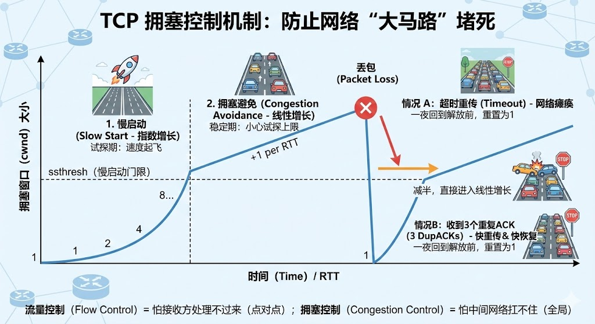

拥塞控制，说白了就是“为了防止网络这条大马路被堵死”。

一定要和“流量控制”区分开：流量控制是怕**接收方**处理不过来；而拥塞控制是怕**中间的路由器和网线**扛不住。如果大家都拼命发包，路由器处理不过来就会丢包，丢包就重传，重传就更堵，最后谁都走不动（拥塞崩溃）。

所以，TCP 需要一个机制来感知路况：**路通就加速，路堵就急刹车**。

它的核心工作流程包含**四个经典的算法**，这通常被称为“慢启动”那一套组合拳：

1. 慢启动（Slow Start）—— 试探期

刚建立连接时，不知道路况如何，不敢太莽撞。

- **做法：** 初始窗口（cwnd）很小（通常是 1），收到一个 ACK 就加倍。1 -> 2 -> 4 -> 8...
- **特点：** 虽然叫“慢”启动，其实是**指数级增长**，速度起飞非常快。直到达到一个“慢启动门限”（ssthresh）为止。
1. 拥塞避免（Congestion Avoidance）—— 稳定期

当窗口增长到门限值（ssthresh）后，说明网络负载差不多了，不能再翻倍了。

- **做法：** 改成**线性增长**。每经过一个 RTT（往返时间），窗口只加 1。小心翼翼地试探网络的上限。
1. 拥塞发生（丢包了）

一直加下去，总有一天会把网络挤爆，这时候就会出现丢包。TCP 会根据丢包的严重程度，采取不同的措施：

- **情况 A：超时重传（最严重）：** 甚至连 ACK 都收不到了。说明网络瘫痪了。
    - **动作：** 直接**一夜回到解放前**。把窗口（cwnd）重置为 1，重新开始慢启动。
- **情况 B：收到 3 个重复 ACK（不太严重）：** 说明有个包丢了，但后续的包对方还能收到，网络还能跑。
    - **动作：** 触发**快重传**和**快恢复**。
1. 快重传与快恢复（Fast Retransmit & Fast Recovery）

这是针对情况 B 的优化。

- **做法：** 既然网络没死透，就别回收到 1 了。先把门限值减半，把窗口也减半（或者设置为减半后的门限值），然后直接进入“拥塞避免”阶段（线性增长）。

---

### 面试标准回答

TCP 的拥塞控制是为了**防止过多的数据注入到网络中，导致网络链路或路由器过载**。它是一个全局性的过程，不同于流量控制的点对点机制。

发送方维护一个**拥塞窗口（cwnd）**，其大小取决于网络的拥塞程度，动态变化。具体工作流程分为四个阶段：

第一，慢启动（Slow Start）：

连接刚建立时，cwnd 初始化为 1，每收到一个 ACK，cwnd 加倍（指数增长）。这用于快速探查网络可用带宽，直到达到慢启动门限（ssthresh）。

第二，拥塞避免（Congestion Avoidance）：

当 cwnd 超过 ssthresh 后，算法由指数增长改为线性增长（每个 RTT 增加 1），以避免网络过早进入拥塞。

第三，快重传（Fast Retransmit）：

如果发送方连续收到 3 个重复的 ACK，说明发生了个别丢包但网络未瘫痪。TCP 会立即重传丢失报文，而不是等待超时。

第四，快恢复（Fast Recovery）：

配合快重传，TCP 不会将 cwnd 重置为 1，而是将 ssthresh 和 cwnd 都减半，然后直接进入拥塞避免阶段（线性增长）。

**只有在发生‘超时重传’（Timeout）这种严重拥塞时**，TCP 才会将 cwnd 重置为 1，重新进入慢启动状态。”
